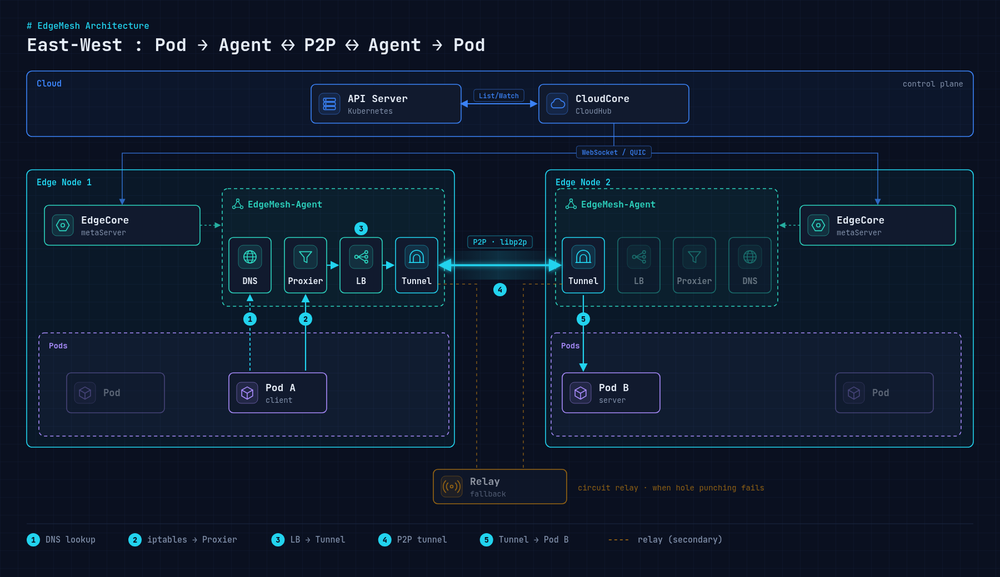

여기까지는 클라우드와 엣지 사이(North-South) 이야기였다. 엣지가 여러 대가 되면 **엣지끼리(East-West)** 서비스를 호출해야 하는 경우가 생긴다. 그런데 엣지에는 kube-proxy도, 클러스터 CNI도 제대로 올라가지 않는다([설치 글](/blog/kubeedge-install-guide/) 참고). 이 빈자리를 채우는 것이 EdgeMesh다.

## EdgeMesh는 무엇인가

- KubeEdge 환경에서 엣지 노드 간 서비스 통신을 지원하는 **경량 서비스 메쉬**다.
- 엣지 노드 사이에 **P2P 기반 오버레이 네트워크**를 만든다.

목적은 네 가지다.

1. 엣지 노드 간 서비스 통신
2. 클라우드를 거치지 않는 엣지 간 직접 통신
3. 엣지 환경의 서비스 디스커버리
4. 엣지 네트워크 안정성 확보

## 구조

<figure>
  <a href="/images/blog/edgemesh-overview/architecture.png">
    
  </a>
</figure>

모든 노드에 EdgeMesh-Agent가 하나씩 뜨고, Agent의 tunnel끼리 P2P로 연결된다. 단순하게 그리면 이렇다.

```text
              Cloud (관리)
                  │
              CloudCore
                  │
      ┌───────────┴────────────┐
      │                        │
 Edge Node A               Edge Node B
     │                         │
   Pod A                      Pod B
     │                         │
 EdgeMesh Agent  <---->  EdgeMesh Agent
        (P2P Overlay Network)
```

### Agent 안의 모듈

| 모듈 | 역할 |
| --- | --- |
| DNS Resolver | 중앙 DNS(CoreDNS)에 기대지 않고 엣지 안에서 서비스 이름을 해석 |
| LoadBalancer | 엣지 노드 사이로 트래픽을 나눠 가용성과 성능을 확보 |
| Proxier (iptables) | 서비스로 가는 패킷을 가로채 실제 대상 Pod로 전달 |
| Tunnel | NAT나 서로 다른 서브넷을 넘는 암호화된 P2P 채널 (libp2p) |

표준 Kubernetes에서는 "CoreDNS + kube-proxy + CNI" 조합이 하는 일을 Agent 하나가 대신하는 셈이다. EdgeMesh 1.12부터는 server가 agent에 통합돼서 배포도 Agent DaemonSet 하나로 끝난다.

## EdgeCore와 무엇이 다른가

처음에 헷갈렸던 지점이다. EdgeMesh는 **데이터를 공유하지 않는다.** 통신 연결만 보장한다.

| 구분 | EdgeCore | EdgeMesh |
| --- | --- | --- |
| 레벨 | 데이터·상태 | 네트워크 |
| 하는 일 | Pod 실행, 메타데이터 사본, 디바이스 트윈 | Pod↔Pod 연결, 서비스 디스커버리, P2P |
| 방향 | 클라우드↔엣지 (North-South) | 엣지↔엣지 (East-West) |
| 끊겼을 때 | 로컬 SQLite로 버팀 | 경로를 다시 찾음 (직접 → relay) |

엣지 A에서 만든 데이터를 엣지 B가 "알게" 되는 것은 EdgeMesh 일이 아니다. EdgeMesh는 A의 앱이 B의 서비스를 이름으로 호출할 수 있게 길을 열어 줄 뿐이다.

## 쓸 때 주의할 점

- EdgeMesh가 없으면 엣지에서 ClusterIP 서비스가 안정적으로 동작하지 않는다.
- 서비스 포트에 `name`을 지정하는 등 몇 가지 사용 규칙을 지켜야 한다.
- 클라우드 노드에 Agent를 같이 올리면 CloudCore 재기동 때 포트 충돌이 날 수 있다. 엣지 노드에만 배포하는 편이 낫다.

실제 배포와 서로 다른 서브넷에 있는 엣지 두 대를 P2P로 붙인 과정은 [EdgeMesh 배포와 P2P(East-West) 통신](/blog/edgemesh-p2p-east-west/)에 이어서 정리했다.
