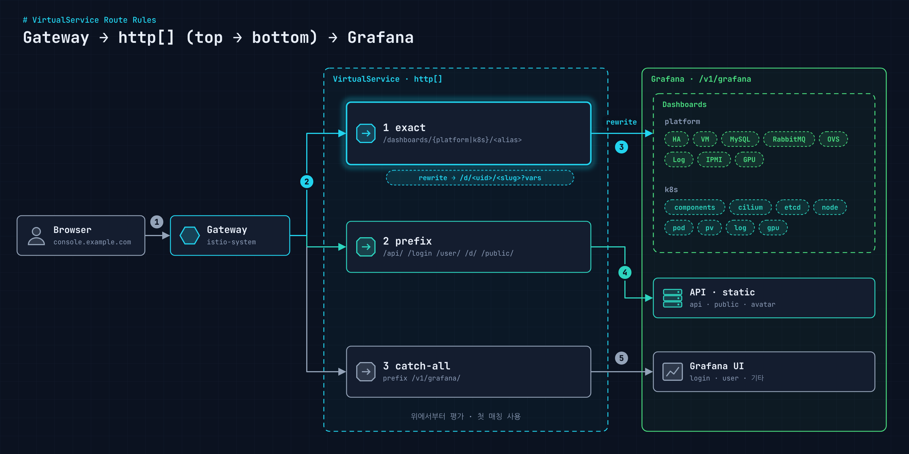

[Grafana 링크 일원화](/blog/grafana-unified-dashboard-routing/)에서 대시보드를 `https://console.example.com/v1/grafana/dashboards/<그룹>/<별칭>` 한 가지 모양으로 모았다. 이번 글은 그 경로를 실제로 만드는 Istio VirtualService 규칙이다.

<figure>
  <a href="/images/blog/grafana-dashboard-route-rules/route-rules.png">
    
  </a>
</figure>

## 대시보드와 UID

Grafana 대시보드 URL은 `/d/<uid>/<slug>?<변수>` 모양이다. UID를 버전 접미사까지 고정해 두면 대시보드를 다시 import해도 주소가 바뀌지 않는다. 아래는 실제 목록을 대분류별로 묶어 패턴만 남긴 것이다(접두사는 `paas-`로 바꿔 적었다).

**플랫폼 대시보드**

| 대분류 | 대시보드 | UID 패턴 | 별칭 경로 |
| --- | --- | --- | --- |
| HA | Cluster Monitoring | `paas-cluster-<ver>` | `/platform/cluster` |
| HA | HAProxy & Pacemaker | `paas-haproxy-pacemaker-<ver>` | `/platform/haproxy-pacemaker` |
| Components | 플랫폼 서비스 Monitoring | `paas-monitoring-<ver>` | `/platform/monitoring` |
| VM | Virtual Machine Resource | `paas-vm-resource-<ver>` | `/platform/vm-resource` |
| Middleware | Memcached / MySQL / RabbitMQ | `paas-memcached-<ver>` 등 | `/platform/memcached`, `/mysql`, `/rabbitmq` |
| Network | Virtual Network(OVS) | `paas-ovs-<ver>` | `/platform/ovs` |
| Log | 플랫폼 Log | `paas-log-<ver>` | `/platform/log` |
| Baremetal | Node IPMI / Node Resource | `paas-ipmi-<ver>`, `paas-node-resource-<ver>` | `/platform/ipmi`, `/node-resource` |
| GPU | GPU Monitoring | `paas-gpu-<ver>` | `/platform/gpu` |

**Kubernetes 대시보드**

| 대분류 | 대시보드 | UID 패턴 | 별칭 경로 |
| --- | --- | --- | --- |
| 기본 컴포넌트 | k8s components | `paas-k8s-components-mon-<ver>` | `/k8s/core-components` |
| 기본 컴포넌트 | CNI(Cilium) | `paas-cni-cilium-mon-<ver>` | `/k8s/cni-dashboards` |
| 기본 컴포넌트 | etcd | `paas-etcd-mon-<ver>` | `/k8s/etcd-status` |
| 기본 컴포넌트 | Node Status | `paas-node-status-mon-<ver>` | `/k8s/node-status` |
| 서비스 | Service(Pod) Monitoring | `paas-service-mon-<ver>` | `/k8s/pod-status` |
| 스토리지 | Persistent Volume | `paas-volume-mon-<ver>` | `/k8s/pv-usage-status` |
| 로그 | Kubernetes Log | `paas-log-mon-<ver>` | `/k8s/log-monitoring` |
| GPU | Host GPU | `paas-gpu-mon-<ver>` | `/k8s/gpu` |

별칭 경로 앞에는 모두 `/v1/grafana/dashboards`가 붙는다.

## 라우팅 규칙 표

| 대상 | 사용자 요청 | 매칭 | 목적지 |
| --- | --- | --- | --- |
| 플랫폼 대시보드 | `/v1/grafana/dashboards/platform/<별칭>` | exact | 특정 대시보드(rewrite) |
| Kubernetes 대시보드 | `/v1/grafana/dashboards/k8s/<별칭>` | exact | 특정 대시보드(rewrite) |
| 공통 | `/v1/grafana/user/` | prefix | 사용자 관리 |
| 공통 | `/v1/grafana/login` | prefix | 로그인 |
| 공통 | `/v1/grafana/api/` | prefix | Grafana API |
| 공통 | `/v1/grafana/d/` | prefix | 대시보드 직접 경로 |
| 공통 | `/v1/grafana/public/` | prefix | 정적 리소스(CSS, JS, 이미지) |
| 공통 | `/v1/grafana/avatar/` | prefix | 아바타 이미지 |
| 공통 | `/v1/grafana/` | prefix | catch-all |

Istio VirtualService는 `http` 목록을 **위에서부터 순서대로** 평가하고 처음 맞는 규칙을 쓴다. 그래서 exact match 대시보드 규칙을 맨 위에, catch-all `/v1/grafana/`를 맨 아래에 둬야 한다. catch-all이 위로 올라가면 별칭 경로가 전부 rewrite 없이 Grafana로 그대로 들어가 404가 난다.

## VirtualService 예시

규칙 하나는 이런 모양이다. 대시보드마다 `match`의 별칭과 `rewrite`의 UID·변수만 다르다.

```yaml
apiVersion: networking.istio.io/v1
kind: VirtualService
metadata:
  name: grafana-dashboards-vs
  namespace: istio-system
spec:
  gateways:
    - istio-system/console-gateway
  hosts:
    - console.example.com
  http:
    # 1. 특정 대시보드 (exact match가 먼저)
    - name: k8s-core-components
      match:
        - uri:
            exact: /v1/grafana/dashboards/k8s/core-components
      rewrite:
        uri: /d/paas-k8s-components-mon-v1/paas-monitoring-components?orgId=1&from=now-1h&to=now&var-datasource=thanos&var-cluster=mgmt
      headers:
        request:
          set:
            Authorization: Bearer %REQ(x-auth-request-access-token)%
      corsPolicy:
        allowOrigins:
          - exact: "*"
        allowMethods: [GET, POST, PATCH, PUT, DELETE, OPTIONS]
        allowHeaders: [content-type, access-control-allow-origin]
      route:
        - destination:
            host: grafana.monitoring.svc.cluster.local
            port:
              number: 80

    # ... 대시보드별 exact 규칙 반복 ...

    # 2. 공통 prefix 경로
    - name: grafana-api
      match:
        - uri:
            prefix: /v1/grafana/api/
      headers:
        request:
          set:
            Authorization: Bearer %REQ(x-auth-request-access-token)%
      route:
        - destination:
            host: grafana.monitoring.svc.cluster.local
            port:
              number: 80

    # user/, login, d/, public/, avatar/ 도 같은 모양

    # 3. catch-all (맨 마지막)
    - name: grafana-catch-all
      match:
        - uri:
            prefix: /v1/grafana/
      route:
        - destination:
            host: grafana.monitoring.svc.cluster.local
            port:
              number: 80
```

볼 만한 부분 세 가지.

- **`rewrite.uri`에 쿼리까지 넣었다.** 시간 범위(`from=now-1h&to=now`), 데이터소스(`var-datasource=thanos`), 클러스터(`var-cluster=mgmt`) 같은 기본 변수를 미리 채워서, 별칭으로 들어가면 바로 의미 있는 화면이 뜬다.
- **`Authorization` 헤더 재설정.** `%REQ(x-auth-request-access-token)%`는 Envoy 포맷 문자열로, OAuth2 Proxy가 넘긴 access token 헤더 값을 꺼내 `Bearer` 토큰으로 다시 세팅한다. 인증 흐름은 [OAuth2 Proxy·Keycloak 글](/blog/grafana-oauth2-keycloak-auth/)에 있다.
- **Grafana가 서브 경로를 알아야 한다.** `/v1/grafana/` 아래에서 서비스하므로 Grafana의 `root_url`을 이 경로로 맞추고 `serve_from_sub_path`를 켜야 정적 리소스와 API 호출 경로가 맞는다.

## 대시보드별 rewrite 예

| 별칭 | rewrite 대상(요약) |
| --- | --- |
| `k8s/cni-dashboards` | `/d/paas-cni-cilium-mon-<ver>/...?var-workload=cilium&var-namespace=$__all` |
| `k8s/etcd-status` | `/d/paas-etcd-mon-<ver>/...?var-job=kube-etcd&var-instance=$__all` |
| `k8s/pv-usage-status` | `/d/paas-volume-mon-<ver>/...?var-pvc_percent_used_warning_threshold=80` |
| `k8s/log-monitoring` | `/d/paas-log-mon-<ver>/...?var-ds=loki&var-namespace=$__all&var-level=$__all` |
| `platform/haproxy-pacemaker` | `/d/paas-haproxy-pacemaker-<ver>/...?var-interval=30s&refresh=5s` |
| `platform/mysql` | `/d/paas-mysql-<ver>/mysql-monitoring?var-interval=1s&refresh=auto` |

## 운영하면서 챙긴 것

- 규칙이 스무 개 가까이 되니 **corsPolicy·헤더 블록이 계속 반복**된다. 헬름 템플릿이나 Kustomize로 별칭·UID 목록만 받아 생성하는 편이 관리가 쉽다.
- 쿼리 문자열 오타(`from=now=1h` 같은)는 대시보드가 열리긴 해도 시간 범위가 이상하게 잡힌다. rewrite 대상은 실제로 한 번씩 열어 보고 넣는다.
- 특정 노드 IP 같은 환경 값은 rewrite에 박지 말고 변수 기본값을 비워 두는 편이 클러스터가 바뀌어도 안전하다.

## 정리

- 별칭 경로는 exact match + rewrite, 공통 경로는 prefix match, 나머지는 catch-all.
- 규칙은 위에서부터 평가되니 **좁은 규칙을 위로, catch-all을 맨 아래로** 둔다.
- rewrite에 기본 변수를 미리 넣어 두면 링크 하나로 원하는 화면까지 바로 간다.
