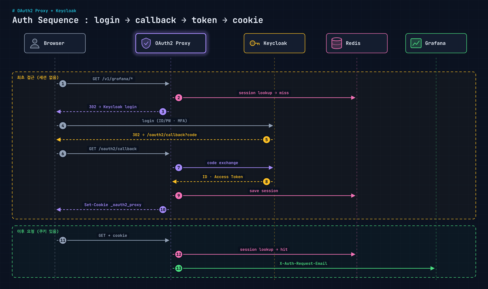

[앞 글](/blog/grafana-unified-dashboard-routing/)에서 Grafana 대시보드를 도메인 하나로 모으고, 인증은 OAuth2 Proxy와 Keycloak에 맡긴다고 했다. 이번에는 그 인증 구조를 열어 본다. Grafana 자체 로그인을 쓰지 않고, 앞단에서 인증을 끝낸 뒤 헤더로 사용자를 넘기는 방식이다.

<figure>
  <a href="/images/blog/grafana-oauth2-keycloak-auth/auth-sequence.png">
    
  </a>
</figure>

## Keycloak

Keycloak은 인증(Authentication)과 인가(Authorization)를 대신 처리하고 SSO를 가능하게 해 주는 오픈소스다.

- **인증**: 누구인지 확인한다.
- **인가**: 무엇을 할 수 있는지 확인한다.
- **SSO(Single Sign-On)**: 한 번 로그인하면 연결된 다른 서비스에도 다시 로그인하지 않고 들어간다.

OpenID Connect, OAuth 2.0, SAML 2.0 세 프로토콜을 지원한다. 여기서는 OIDC로 OAuth2 Proxy와 붙였다.

## OAuth2 Proxy

OAuth2 Proxy는 외부 인증 제공자(OAuth2, OIDC 등)를 이용해 로그인 인증을 대신 처리해 주는 **인증 게이트웨이**다. 서비스 앞단에서 "로그인 됐나?"만 확인하고, 됐으면 뒤로 넘기고 안 됐으면 인증 서버로 돌려보낸다. 뒤에 있는 서비스는 인증 코드를 따로 갖지 않아도 된다.

## 구성 요소별 역할

| 구성 요소 | 역할 | 콘솔과의 관계 |
| --- | --- | --- |
| Keycloak | SSO, OAuth2, OIDC 인증 서버 | 콘솔 사용자 로그인과 권한 인증 제공 |
| MariaDB | Keycloak의 사용자, 세션, 클라이언트 정보 저장 | 콘솔 사용자·관리자 계정 정보도 여기에 있음 |
| OAuth2 Proxy | 콘솔·Grafana 앞단에서 Keycloak 인증을 중계 | 접근 전에 먼저 인증을 유도 |
| Redis | 세션 캐시 저장소 | 여러 사용자의 로그인 세션을 효율적으로 관리 |

## 구성 요소 관계

```text
사용자 브라우저
   │
   ▼
[ OAuth2 Proxy ]
   │ 로그인 필요
   ▼
[ Keycloak ]
   │ 사용자 인증
   ▼
[ MariaDB ]
   │ 사용자 정보 조회
   ▼
[ OAuth2 Proxy ]
   │ 인증된 사용자 세션 유지
   ▼
[ Redis ]
   │ 세션 저장/조회
   ▼
[ 실제 애플리케이션(Grafana) ]
```

Redis를 따로 두는 이유는 OAuth2 Proxy 파드가 여러 개일 때다. 세션을 쿠키에만 담거나 파드 메모리에 두면 요청이 다른 파드로 갔을 때 로그인이 풀릴 수 있다. Redis에 두면 어느 파드로 가든 같은 세션을 본다.

## 전체 인증 흐름

```text
[User Browser]
      │
      ▼
[OAuth2 Proxy]
      │  [1] 인증되지 않은 요청 감지
      │  [2] Keycloak으로 리디렉션
      ▼
[Keycloak (SSO 서버)]
      │  [3] 사용자 로그인 (ID/PW, MFA 또는 외부 SSO)
      ▼
[OAuth2 Proxy]
      │  [4] 인증 완료 → Access Token + ID Token 수신
      │  [5] 세션 쿠키 생성, 세션은 Redis에 저장
      │  [6] 요청에 헤더 추가 (X-Auth-Request-Email: user@example.com)
      ▼
[Grafana (auth.proxy.enabled = true)]
      │  [7] 헤더 확인 후 자동 로그인
      │  [8] auto_sign_up = true → 내부 사용자 자동 생성
      ▼
[Grafana 접근 완료]
```

## 단계별로 보면

| 단계 | 설명 |
| --- | --- |
| ① 사용자 요청 | 사용자가 Grafana 경로(`https://console.example.com/v1/grafana/...`)로 요청 |
| ② OAuth2 Proxy 가로채기 | Grafana보다 OAuth2 Proxy가 먼저 요청을 받음 |
| ③ 인증 여부 확인 | 세션 쿠키가 없거나 Redis에 유효한 세션이 없으면 Keycloak 로그인 화면으로 리디렉션 |
| ④ 사용자 인증 | Keycloak이 패스워드, MFA, SSO 등으로 인증 |
| ⑤ 토큰 수신 | OAuth2 Proxy가 ID Token, Access Token을 받음 |
| ⑥ 헤더 주입 | 사용자 이메일을 `X-Auth-Request-Email` 헤더에 넣음 |
| ⑦ Grafana 접속 | 프록시 뒤의 Grafana로 요청 전달 |
| ⑧ 자동 로그인 | Grafana가 auth.proxy 설정으로 헤더를 읽고 로그인 처리 |
| ⑨ 사용자 자동 등록 | Grafana DB에 없는 사용자면 자동 생성(`auto_sign_up = true`) |

## Grafana 쪽 설정

Grafana는 auth proxy 모드를 켜고, 어느 헤더를 사용자 식별자로 쓸지 정해 준다.

```ini
[auth.proxy]
enabled = true
header_name = X-Auth-Request-Email
header_property = email
auto_sign_up = true
```

여기서 중요한 건 **이 헤더를 OAuth2 Proxy만 붙일 수 있어야 한다**는 점이다. 클라이언트가 직접 `X-Auth-Request-Email`을 넣어 Grafana로 바로 들어오면 아무 사용자로나 로그인할 수 있다. 그래서 Grafana는 메시 밖으로 직접 노출하지 않고, 반드시 Gateway → OAuth2 Proxy를 거쳐서만 닿게 한다.

VirtualService에서는 OAuth2 Proxy가 넘겨준 access token을 `Authorization` 헤더로 다시 세팅해 뒤로 넘긴다. 이 부분은 [대시보드 라우팅 규칙](/blog/grafana-dashboard-route-rules/) 글의 VirtualService 예시에 있다.

## 정리

- 인증은 Keycloak, 사용자 저장은 MariaDB, 세션은 Redis, 중계는 OAuth2 Proxy로 역할을 나눴다.
- Grafana는 로그인 화면 없이 헤더만 보고 로그인하고, 처음 온 사용자는 자동 생성한다.
- 헤더 신뢰 모델이라 Grafana로 가는 길은 OAuth2 Proxy 하나로만 열어 둬야 한다.
