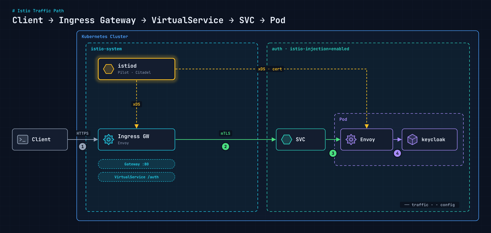
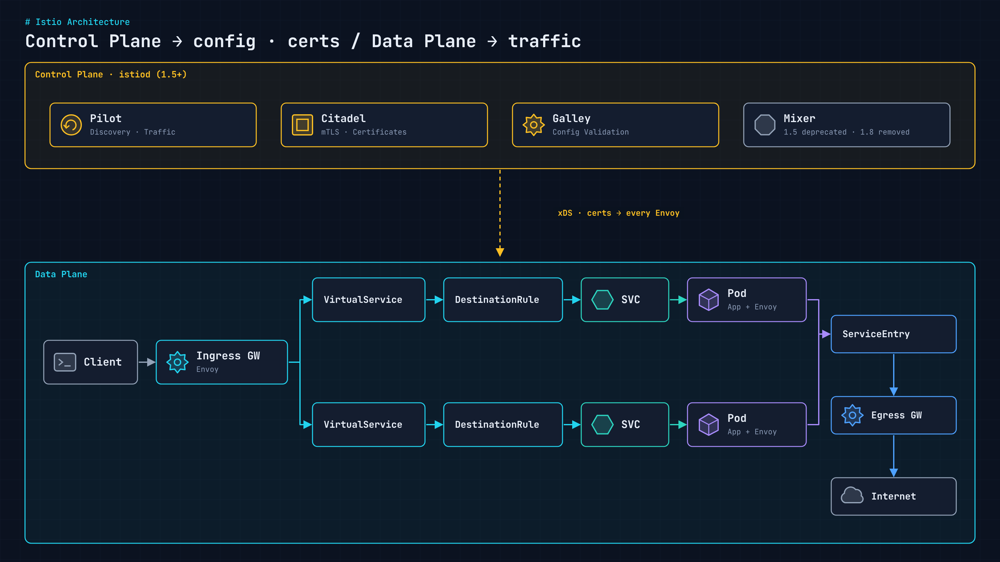
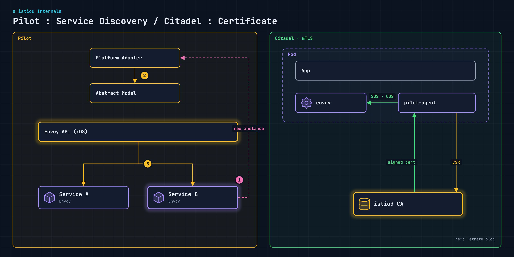

사내 Kubernetes PaaS는 서비스 메시로 Istio를 쓴다. 외부 요청은 모두 Istio Ingress Gateway로 들어오고, 메시 안의 워크로드에는 Envoy 사이드카가 붙어 있다. [istiod가 내려가면 무슨 일이 생기는지](/blog/istiod-outage-impact/) 보기 전에, 먼저 트래픽이 어떻게 흐르고 istiod가 그 사이에서 무엇을 맡는지 정리해 둔다.

## 외부 요청 경로

<figure>
  <a href="/images/blog/istio-paas-architecture/traffic.png">
    
  </a>
</figure>

1. **Client → Ingress Gateway**: 외부 요청은 `istio-system`의 Ingress Gateway Pod(Envoy)로 들어온다.
2. **Gateway → SVC**: Gateway 리소스가 받을 호스트와 포트를 정하고, VirtualService가 경로를 보고 목적지 Service를 고른다. 메시 안 구간은 Envoy끼리 mTLS로 통신한다.
3. **SVC → Envoy 사이드카**: `istio-injection=enabled` 네임스페이스의 Pod에는 사이드카가 자동 주입되어 있어서, 트래픽은 먼저 사이드카가 받는다.
4. **Envoy → 앱 컨테이너**: 사이드카가 같은 Pod 안의 앱(여기서는 Keycloak)으로 넘긴다.

점선은 트래픽이 아니라 **설정**이다. Gateway·VirtualService·DestinationRule 같은 리소스는 istiod가 Envoy 설정(xDS)으로 바꿔 Ingress Gateway와 모든 사이드카에 내려준다.

## Gateway와 VirtualService

실제 구성은 Gateway 하나가 메인 도메인의 80 포트를 받고, VirtualService가 경로별로 서비스를 나눈다. 예를 들어 `/auth`는 Keycloak으로 보낸다. 도메인과 이름은 예시로 바꿨다.

```yaml
apiVersion: networking.istio.io/v1beta1
kind: Gateway
metadata:
  name: main-gateway
  namespace: istio-system
spec:
  selector:
    istio: gateway          # 이 라벨이 붙은 Ingress Gateway Pod가 받는다
  servers:
    - hosts:
        - console.example.com
      port:
        name: http2
        number: 80
        protocol: HTTP
```

```yaml
apiVersion: networking.istio.io/v1beta1
kind: VirtualService
metadata:
  name: keycloak
  namespace: auth
spec:
  gateways:
    - istio-system/main-gateway
  hosts:
    - console.example.com
  http:
    - match:
        - uri:
            prefix: /auth
      route:
        - destination:
            host: keycloak.auth.svc.cluster.local
            port:
              number: 8080
```

| 리소스 | 맡는 일 |
| --- | --- |
| Gateway | `selector`로 어떤 Ingress Gateway Pod가 받을지, 어떤 호스트·포트를 열지 |
| VirtualService | 들어온 요청을 경로(`/auth` 등)로 나눠 목적지 Service로 라우팅 |
| DestinationRule | 목적지에 도착한 뒤의 정책(로드밸런싱, 서브셋, TLS 모드) |

같은 Gateway에 경로 규칙을 붙여 Grafana 같은 다른 서비스도 한 도메인 아래로 모았다. 그 구성은 [Grafana 링크 일원화](/blog/grafana-unified-dashboard-routing/)에 따로 정리했다.

## 컨트롤 플레인과 데이터 플레인

<figure>
  <a href="/images/blog/istio-paas-architecture/planes.png">
    
  </a>
</figure>

Istio는 두 층으로 나뉜다.

- **컨트롤 플레인**은 설정과 인증서를 배포한다. 1.5부터는 Pilot, Citadel, Galley가 **istiod** 바이너리 하나로 합쳐졌다.
- **데이터 플레인**은 실제 트래픽을 처리한다. Ingress Gateway, 각 Pod의 Envoy 사이드카, 바깥으로 나가는 Egress Gateway가 여기에 속한다.

| 구성 요소 | 역할 |
| --- | --- |
| Pilot | Service Discovery, 트래픽 관리(라우팅, retry, timeout, circuit breaker) |
| Citadel | 인증, mTLS, 키와 인증서 관리 |
| Galley | 사용자가 작성한 Istio 설정 검증 |
| Mixer | 정책 검사, 텔레메트리 수집. 1.5에서 폐기, 1.8에서 제거 |

메시 밖으로 나가는 트래픽은 ServiceEntry로 외부 목적지를 등록하고 Egress Gateway를 거쳐 나간다.

## istiod 안쪽: Pilot과 Citadel

<figure>
  <a href="/images/blog/istio-paas-architecture/istiod.png">
    
  </a>
</figure>

### Pilot: Service Discovery와 트래픽 규칙

1. 새 인스턴스가 생기면 Platform Adapter가 알림을 받는다.
2. Platform Adapter는 플랫폼(Kubernetes)의 정보를 Istio 내부의 Abstract Model로 바꾼다.
3. Envoy API(xDS)가 바뀐 엔드포인트와 트래픽 규칙을 모든 Envoy에 내려준다.

각 Envoy는 Pilot에게 받은 다른 인스턴스 정보로 로드밸런싱을 한다. VirtualService, DestinationRule, AuthorizationPolicy, Sidecar 같은 리소스가 생성·수정·삭제될 때마다 그걸 **Envoy 문법으로 컴파일해서 각 Envoy에 업데이트하는 것**도 istiod의 일이다.

### Citadel: mTLS 인증서

메시 안 마이크로서비스 사이 통신을 mTLS로 암호화하려면 Envoy마다 고유한 인증서가 있어야 한다.

1. Pod 안의 `pilot-agent`가 키를 만들고 istiod CA에 CSR을 보낸다.
2. istiod가 서명한 인증서를 돌려준다.
3. `pilot-agent`가 UDS 소켓 위의 SDS로 Envoy에 인증서를 넘긴다.

인증서 발급 흐름은 Tetrate 블로그의 설명을 참고했다.

## 정리

| 질문 | 답 |
| --- | --- |
| 트래픽은 어디로 흐르나 | Ingress Gateway → VirtualService → SVC → Envoy 사이드카 → 앱. 메시 안 구간은 mTLS |
| istiod는 트래픽을 받나 | 아니다. 설정(xDS)과 인증서만 내려준다 |
| istiod가 하는 일 | Service Discovery, 트래픽 규칙 컴파일·배포, mTLS 인증서 발급, 사이드카 주입 |

istiod는 트래픽 경로 위에 있지 않다. 그래서 istiod가 내려가도 바로 모든 통신이 끊기지는 않는다. 대신 **무언가 새로 생길 때** 문제가 드러난다. 그 이야기는 [다음 글](/blog/istiod-outage-impact/)에서 다룬다.
