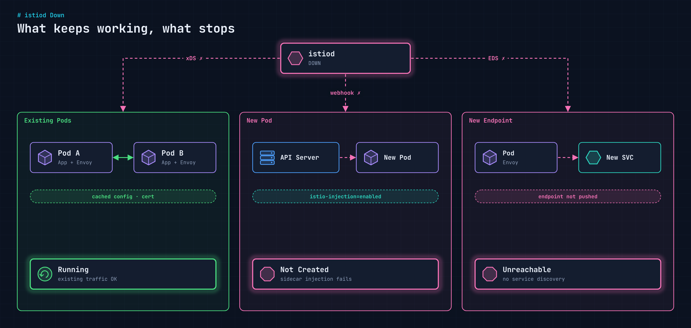

[앞 글](/blog/istio-paas-architecture/)에서 본 것처럼 istiod는 트래픽 경로 위에 있지 않다. 설정(xDS), 인증서, 사이드카 주입을 맡을 뿐이다. 그렇다면 **istiod가 있다가 없어지면** 데이터 플레인은 어떻게 될까. 사내 Kubernetes PaaS에서 istiod를 내린 상태로 확인했다.

## 한 장으로 보기

<figure>
  
</figure>

## 결과

| 상태 | 영역 | istiod 다운 후 | 원인 |
| --- | --- | --- | --- |
| 정상 | 기존 Pod (Envoy 사이드카 부착) | 계속 Running, 기존 통신 유지 | 이미 주입된 사이드카와 받아 둔 설정이 그대로 동작 |
| 장애 | `istio-injection=enabled` 네임스페이스 신규 Pod 배포 | 신규 Pod가 뜨지 않음 | 사이드카 주입을 수행할 istiod 부재 |
| 장애 | Service Discovery | 새 Service를 띄워 엔드포인트가 추가되면 통신 불가 | 사이드카 워크로드가 새 엔드포인트를 받지 못함 |

### 기존 Pod: 그대로 통신한다

사이드카가 붙어 있던 Pod들은 아무 영향 없이 떠 있고 서로 통신도 잘 된다. Envoy는 istiod에게 마지막으로 받은 리스너·라우트·엔드포인트 설정과 인증서를 메모리에 들고 있어서, 컨트롤 플레인이 사라져도 지금 하던 일은 계속한다.

### 신규 Pod: 만들어지지 않는다

문제는 istiod가 없어진 **뒤에** 배포할 때 생긴다. `istio-injection=enabled` 네임스페이스에 Pod를 만들면 API Server가 사이드카 주입 webhook을 부르는데, 그 webhook을 처리하는 게 istiod다. 응답할 곳이 없으니 Pod 생성이 막힌다. 롤링 업데이트, 스케일 아웃, 노드 장애로 인한 재스케줄까지 모두 여기에 걸린다.

### 새 엔드포인트: 도달하지 못한다

새 Service를 띄워 엔드포인트가 추가돼도, 그 사실을 Envoy에 알려 줄 istiod가 없다. 사이드카가 붙은 워크로드는 새 엔드포인트를 모르는 채로 남아 그 Service로 통신하지 못한다.

## 그래서 운영에서는

- **istiod 장애는 "조용한 장애"다.** 당장은 트래픽이 흐르니 모니터링에서 놓치기 쉽다. 다음 배포나 재스케줄 때 한꺼번에 터진다.
- **istiod가 내려가 있는 동안에는 배포를 멈춘다.** 새 Pod와 새 Service 모두 정상 동작을 기대할 수 없다.
- **istiod를 먼저 살린 뒤** 사이드카 주입과 엔드포인트 전파가 되는지 확인하고 나서 배포를 재개한다.

istiod는 트래픽을 받지 않지만, 메시가 **변화**를 받아들이려면 반드시 있어야 하는 구성 요소다.
