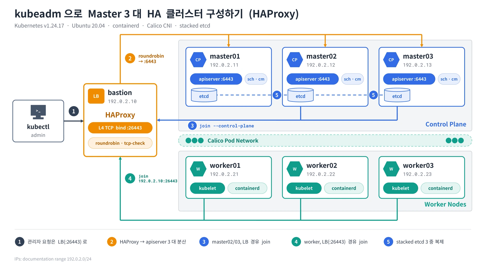

kubeadm과 HAProxy로 컨트롤 플레인 3대, 워커 3대를 붙인 구성이다.

<figure>
  <a href="/images/blog/kubeadm-ha-master3-haproxy/architecture.webp">
    
  </a>
</figure>

## 소개

**컨테이너**라고 불리는 소규모 가상 환경은 애플리케이션을 개발하고 관리하는데 없어서는 안 될 요소가 되었습니다. 격리된 컨테이너 내의 애플리케이션 작업은 호스트 운영 체제에 영향을 주지 않습니다. 컨테이너는 운영체제가 필요하지 않으므로 **Kubernetes**는 여러 컨테이너에 걸쳐 리소스를 배포, 확장 및 관리하는데 도움이 되는 오픈 소스 플랫폼입니다.

## 사전 요구 사항

- VM 구성 (총 7개)

| Name | Role | IP | Version |
|---|---|---|---|
| bastion | HAProxy | 192.0.2.10 | v1.24.17 |
| master01 | control-plane | 192.0.2.11 | v1.24.17 |
| master02 | control-plane | 192.0.2.12 | v1.24.17 |
| master03 | control-plane | 192.0.2.13 | v1.24.17 |
| worker01 | worker-node | 192.0.2.21 | v1.24.17 |
| worker02 | worker-node | 192.0.2.22 | v1.24.17 |
| worker03 | worker-node | 192.0.2.23 | v1.24.17 |

## 1. 컨테이너 런타임 설치

Control Plane, Worker Node 공통 작업이다.

**docker repository 생성**

```bash
# Add Docker's official GPG key:
sudo apt-get update
sudo apt-get install ca-certificates curl gnupg
sudo install -m 0755 -d /etc/apt/keyrings
curl -fsSL https://download.docker.com/linux/ubuntu/gpg | sudo gpg --dearmor -o /etc/apt/keyrings/docker.gpg
sudo chmod a+r /etc/apt/keyrings/docker.gpg

# Add the repository to Apt sources:
echo \
  "deb [arch=$(dpkg --print-architecture) signed-by=/etc/apt/keyrings/docker.gpg] https://download.docker.com/linux/ubuntu \
  $(. /etc/os-release && echo "$VERSION_CODENAME") stable" | \
  sudo tee /etc/apt/sources.list.d/docker.list > /dev/null
sudo apt-get update
```

**docker package 설치**

```bash
sudo apt-get install docker-ce docker-ce-cli containerd.io docker-buildx-plugin docker-compose-plugin
```

## 2. 필수 요소 설치 및 구성

Control Plane, Worker Node 공통 작업이다.

### IPv4 포워딩

IPv4를 포워딩해서 iptables가 bridged traffic을 확인하고 제어할 수 있도록 합니다.

```bash
cat <<EOF | sudo tee /etc/modules-load.d/k8s.conf
overlay
br_netfilter
EOF

sudo modprobe overlay
sudo modprobe br_netfilter

# 필요한 sysctl 파라미터를 설정하면, 재부팅 후에도 값이 유지된다.
cat <<EOF | sudo tee /etc/sysctl.d/k8s.conf
net.bridge.bridge-nf-call-iptables = 1
net.bridge.bridge-nf-call-ip6tables = 1
net.ipv4.ip_forward = 1
EOF

# 재부팅하지 않고 sysctl 파라미터 적용하기
sudo sysctl --system
```

### cgroup 드라이버

- cgroup(Control Groups)은 리눅스 커널에서 제공하는 기능으로, 프로세스 그룹을 관리하고 제어할 수 있게 해주는 기술
- 다양한 리소스(CPU, 메모리, 디스크 I/O 등)에 대한 프로세스 그룹의 자원 소비를 제한하고 모니터링 할 수 있습니다. kubelet과 컨테이너 런타임이 control group들과 상호작용하기 위해서는 cgroup 드라이버를 사용해야 한다.

**cgroup 드라이버 종류: cgroupfs, systemd**

- cgroupfs

cgroupfs 드라이버가 권장되지 않는 때가 있는데, systemd가 init 시스템인 경우이다. 이것은 systemd가 시스템에 단 하나의 cgroup 관리자만 있을 것으로 기대하기 때문입니다. cgroup v2를 사용할 경우에도 cgroupfs 대신 systemd cgroup 드라이버를 사용합니다.

- systemd

systemd를 cgroup 드라이버로 사용하기 위해서는 [KubeletConfiguration](https://kubernetes.io/docs/tasks/administer-cluster/kubelet-config-file/)을 수정하여 cgroupDriver 옵션을 systemd로 지정하는 것입니다. systemd를 kubelet의 cgroup 드라이버로 구성했다면, 반드시 컨테이너 런타임의 cgroup 드라이버 또한 systemd로 설정해야 합니다.

```bash
# cgroupfs를 컨테이너 런타임과 kubelet에 의해서 제어할 수 있도록 구성한다.
sudo mkdir /etc/docker

cat <<EOF | sudo tee /etc/docker/daemon.json
{
  "exec-opts": ["native.cgroupdriver=systemd"],
  "log-driver": "json-file",
  "log-opts": {
    "max-size": "100m"
  },
  "storage-driver": "overlay2"
}
EOF

sudo systemctl enable docker
sudo systemctl daemon-reload
sudo systemctl restart docker
```

## 3. kubeadm, kubelet 및 kubectl 설치

control plane, worker node 공통 작업이다.

1. apt 패키지 색인을 업데이트하고, 쿠버네티스 apt 리포지터리를 사용하는 데 필요한 패키지를 설치한다.

```bash
sudo apt-get update
sudo apt-get install -y apt-transport-https ca-certificates curl
```

2. 구글 클라우드의 공개 사이닝 키를 다운로드한다.

```bash
sudo curl -fsSL https://pkgs.k8s.io/core:/stable:/v1.24/deb/Release.key | sudo gpg --dearmor -o /etc/apt/keyrings/kubernetes-apt-keyring.gpg
```

3. 쿠버네티스 apt 리포지터리를 추가한다.

```bash
echo "deb [signed-by=/etc/apt/keyrings/kubernetes-apt-keyring.gpg] https://pkgs.k8s.io/core:/stable:/v1.24/deb/ /" | sudo tee /etc/apt/sources.list.d/kubernetes.list
```

4. apt 패키지 색인을 업데이트하고, kubelet, kubeadm, kubectl을 설치하고 해당 버전을 고정한다.

```bash
sudo apt-get update
sudo apt-get install -y kubelet kubeadm kubectl
sudo apt-mark hold kubelet kubeadm kubectl
```

## 4. Bastion HAProxy

백엔드 서버에는 컨트롤 플레인의 IP 주소를 넣어 준다. 내 경우에 컨트롤 플레인의 IP 주소는 다음에 해당한다.

- 192.0.2.11
- 192.0.2.12
- 192.0.2.13

```bash
# bastion 서버에만 실행
# HAProxy 설치
sudo apt-get update
sudo apt-get install haproxy

# HAProxy 설정
cat <<EOF >> /etc/haproxy/haproxy.cfg
frontend kubernetes-master-lb
    bind 0.0.0.0:26443
    option tcplog
    mode tcp
    default_backend kubernetes-master-nodes

backend kubernetes-master-nodes
    mode tcp
    balance roundrobin
    option tcp-check
    option tcplog
    server master1 192.0.2.11:6443 check
    server master2 192.0.2.12:6443 check
    server master3 192.0.2.13:6443 check
EOF

# HAProxy 재시작
systemctl restart haproxy && systemctl enable haproxy
systemctl status haproxy
```

## 5. master01 설정

클러스터를 초기화할 때 컨트롤 플레인 엔드포인트를 설정하면 컨트롤 플레인 간의 통신을 할 수 있다. 컨트롤 플레인 엔드포인트는 HAProxy가 설치된 bastion 서버의 IP 주소(192.0.2.10)를 넣어 준다.

```bash
# kubeadm init 명령어 오류가 발생하면: 컨테이너 런타임 설정파일 삭제 후 재시작
sudo rm /etc/containerd/config.toml
sudo systemctl restart containerd

# 클러스터 초기화
sudo kubeadm init --control-plane-endpoint=192.0.2.10:26443 --upload-certs --pod-network-cidr=10.0.0.0/24
```

초기화가 끝나면 아래와 같은 안내가 나온다. 이 출력이 나오면 클러스터가 생성된 것이다.

```text
To start using your cluster, you need to run the following as a regular user:

  mkdir -p $HOME/.kube
  sudo cp -i /etc/kubernetes/admin.conf $HOME/.kube/config
  sudo chown $(id -u):$(id -g) $HOME/.kube/config

Alternatively, if you are the root user, you can run:

  export KUBECONFIG=/etc/kubernetes/admin.conf

You should now deploy a pod network to the cluster.
Run "kubectl apply -f [podnetwork].yaml" with one of the options listed at:
  https://kubernetes.io/docs/concepts/cluster-administration/addons/

You can now join any number of the control-plane node running the following command on each as root:

  kubeadm join 192.0.2.10:26443 --token <TOKEN> \
    --discovery-token-ca-cert-hash sha256:<DISCOVERY_TOKEN_CA_CERT_HASH> \
    --control-plane --certificate-key <CERTIFICATE_KEY>

Please note that the certificate-key gives access to cluster sensitive data, keep it secret!
As a safeguard, uploaded-certs will be deleted in two hours; If necessary, you can use
"kubeadm init phase upload-certs --upload-certs" to reload certs afterward.

Then you can join any number of worker nodes by running the following on each as root:

kubeadm join 192.0.2.10:26443 --token <TOKEN> \
  --discovery-token-ca-cert-hash sha256:<DISCOVERY_TOKEN_CA_CERT_HASH>
```

## A. master01에 kubeconfig 넣기

① 번 코드를 먼저 master01에 입력한다.

```bash
mkdir -p $HOME/.kube
sudo cp -i /etc/kubernetes/admin.conf $HOME/.kube/config
sudo chown $(id -u):$(id -g) $HOME/.kube/config
```

## B. master02, master03 조인

master02, master03에 ② 번 코드를 입력한다.

```bash
kubeadm join 192.0.2.10:26443 --token <TOKEN> \
  --discovery-token-ca-cert-hash sha256:<DISCOVERY_TOKEN_CA_CERT_HASH> \
  --control-plane --certificate-key <CERTIFICATE_KEY>

# kubeadm init 명령어 오류가 발생하면: 컨테이너 런타임 설정파일 삭제 후 재시작
sudo rm /etc/containerd/config.toml
sudo systemctl restart containerd

# 클러스터 리셋
sudo kubeadm reset
```

## C. master02, master03 kubeconfig

조인이 끝나면 각 노드에서 아래를 실행한다.

```bash
mkdir -p $HOME/.kube
sudo cp -i /etc/kubernetes/admin.conf $HOME/.kube/config
sudo chown $(id -u):$(id -g) $HOME/.kube/config
```

## D. master01~03 조인 확인

```text
root@master01:/etc/kubernetes# kubectl get nodes -o wide
NAME       STATUS     ROLES           AGE     VERSION    INTERNAL-IP    EXTERNAL-IP   OS-IMAGE             KERNEL-VERSION       CONTAINER-RUNTIME
master01   NotReady   control-plane   45m     v1.24.17   192.0.2.11     <none>        Ubuntu 20.04.4 LTS   5.15.0-113-generic   containerd://1.7.18
master02   NotReady   control-plane   30m     v1.24.17   192.0.2.12     <none>        Ubuntu 20.04.4 LTS   5.15.0-113-generic   containerd://1.7.18
master03   NotReady   control-plane   7m59s   v1.24.17   192.0.2.13     <none>        Ubuntu 20.04.4 LTS   5.15.0-113-generic   containerd://1.7.18
```

## 6. worker join

```bash
# worker1, worker2, worker3
# join 오류가 발생하면: 컨테이너 런타임 설정파일 삭제 후 재시작
sudo rm /etc/containerd/config.toml
sudo systemctl restart containerd

# 조인
kubeadm join 192.0.2.10:26443 --token <TOKEN> \
  --discovery-token-ca-cert-hash sha256:<DISCOVERY_TOKEN_CA_CERT_HASH>
```

조인 완료 시 확인해 보면 NotReady 상태인데, 네트워크 플러그인을 설치하지 않아서이다.

## Calico 설치

```bash
curl https://docs.projectcalico.org/archive/v3.17/manifests/calico.yaml -O
```

```text
  % Total    % Received % Xferd  Average Speed   Time    Time     Time  Current
                                 Dload  Upload   Total   Spent    Left  Speed
100  183k  100  183k    0     0   120k      0  0:00:01  0:00:01 --:--:--   120k
```

### Calico 배포

```bash
kubectl apply -f calico.yaml
```

### Worker node role 변경

`kubectl label node <node-name> <key>=<value>` 명령으로 노드의 레이블 값을 수정할 수 있다.

```bash
# 노드 이름과 ROLES를 동일하게 바꾸고자 한다
kubectl label node worker01 node-role.kubernetes.io/worker01=worker01
kubectl label node worker02 node-role.kubernetes.io/worker02=worker02
kubectl label node worker03 node-role.kubernetes.io/worker03=worker03
```

### Ready 상태 확인
