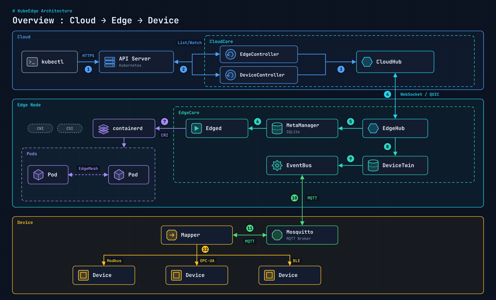
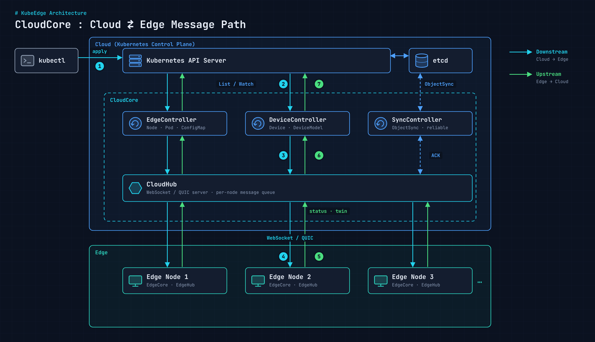
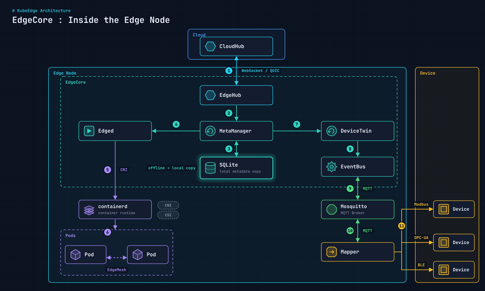

[개요](/blog/kubeedge-overview/)에서 KubeEdge가 CloudCore와 EdgeCore 두 덩어리라는 것까지 봤다. 이번에는 그 안을 열어서 모듈마다 무슨 일을 하는지, 엣지라서 어떤 제약이 생기는지 정리한다.

## 세 영역으로 나눠 보기

<figure>
  <a href="/images/blog/kubeedge-architecture/overview.png">
    
  </a>
</figure>

KubeEdge 구성도는 크게 세 영역이다.

1. **클라우드 영역**: 제어의 중심. Kubernetes 컨트롤 플레인과 CloudCore(CloudHub, EdgeController, DeviceController)가 있다.
2. **엣지 영역**: 실행과 처리의 중심. EdgeCore, EdgeMesh, Mapper, Mosquitto가 있다.
3. **디바이스 영역**: 실제 센서와 제어 장치. Modbus, Bluetooth, OPC UA 같은 프로토콜로 Mapper와 이야기한다.

클라우드와 엣지 사이는 기본이 WebSocket이고, QUIC을 대안으로 쓸 수 있다.

## CloudCore: 제어 영역

<figure>
  <a href="/images/blog/kubeedge-architecture/cloudcore.png">
    
  </a>
</figure>

| 모듈 | 역할 |
| --- | --- |
| CloudHub | 엣지와의 WebSocket 서버. 클라우드 쪽 변화를 감지해 EdgeHub로 메시지를 보낸다 |
| EdgeController | 노드·Pod 메타데이터를 관리해 데이터가 맞는 엣지 노드로 가게 하는 확장 컨트롤러 |
| DeviceController | 디바이스 메타데이터와 상태를 클라우드↔엣지 간에 동기화하는 확장 컨트롤러 |
| SyncController | 클라우드-엣지 간 데이터 정합성과 신뢰성 보장 |
| Admission Webhook | 확장 API 요청의 입력값 검증 |
| CSI Driver | 외부 스토리지 플러그인 연결 |

핵심은 **집계**다. 수천 개 엣지가 API Server를 직접 두드리지 않고, CloudCore가 List/Watch로 받은 변경을 모아서 엣지별로 나눠 보낸다. 중앙 API Server 부하를 구조적으로 피하는 방식이다.

CloudCore가 처음 뜰 때 로그를 보면 이 모듈들이 순서대로 올라온다.

```text
Module cloudhub registered successfully
Module edgecontroller registered successfully
Module devicecontroller registered successfully
Module synccontroller registered successfully
Module cloudStream registered successfully
...
start upstream controller        # Edge → Cloud 메시지 처리
Start downstream devicecontroller
start downstream controller      # Cloud → Edge 리소스 전달
Starting cloudhub websocket server
```

`taskmanager`, `router`, `dynamiccontroller`, `policycontroller`는 기본 설정에서 비활성이라 `is disabled, do not register`가 찍힌다. 장애가 아니다.

## EdgeCore: 실행 영역

<figure>
  <a href="/images/blog/kubeedge-architecture/edgecore.png">
    
  </a>
</figure>

| 모듈 | 역할 |
| --- | --- |
| EdgeHub | 클라우드(CloudHub)와 WebSocket/QUIC으로 통신하는 클라이언트. 엣지 상태를 클라우드로 올린다 |
| MetaManager | Edged와 EdgeHub 사이 메시지 처리기. 메타데이터를 로컬 SQLite에 저장하고 꺼낸다 |
| Edged | 경량 kubelet. Pod, Volume, Node 생명주기 관리 |
| DeviceTwin | 디바이스 상태를 저장하고 클라우드와 동기화. 앱에 조회 인터페이스 제공 |
| EventBus | MQTT 브로커와 통신하는 클라이언트 |
| ServiceBus | HTTP 서버와 통신. 클라우드 모듈이 엣지의 HTTP 서버에 접근하게 해 준다 |

여기서 단절 대응의 핵심은 MetaManager다. 클라우드에서 받은 Pod·ConfigMap·Secret을 SQLite에 사본으로 남겨 두기 때문에, 통신이 끊겨도 엣지는 마지막 지시대로 계속 돈다. 이 부분은 [North-South 데이터 보장 글](/blog/kubeedge-north-south-reliability/)에서 실제 DB를 열어 확인했다.

장치 쪽(DeviceTwin, EventBus, Mapper, Mosquitto)의 경계는 [Device, Mapper, MQTT 글](/blog/kubeedge-device-mapper-mqtt/)에 따로 정리했다.

### 동작을 한 줄 그림으로

```text
                ┌─────────────────────┐
                │  Cloud (K8s CP)     │   - 정책 정의, 배포, RBAC/인증
                │  API Server         │   - CloudCore: 엣지 등록·동기화
                │  CloudCore          │
                └─────────┬───────────┘
                          │ WebSocket / QUIC
          ┌───────────────┴───────────────┐
   ┌──────┴────────┐               ┌──────┴────────┐
   │  Edge Node A  │               │  Edge Node B  │   - CloudCore와 통신
   │  EdgeCore     │               │  EdgeCore     │   - 로컬 Pod 실행
   │  Pods         │               │  Pods         │   - 끊겨도 실행 유지
   │  Device I/O   │               │  Sensor I/O   │   - 재연결 시 상태 동기화
   └───────────────┘               └───────────────┘
```

## 어디에 쓰나

KubeEdge 레퍼런스를 보면 규모가 꽤 크다. 고속도로 엣지-클라우드 협업에서 엣지 노드 약 10만 대, 엣지 애플리케이션 50만 개를 운영한 사례가 있고, 위성-지상, 차량-클라우드, 유전 설비, CDN 노드 관리 사례도 있다.

시나리오로 묶으면 네 가지다.

| 시나리오 | 환경 | 핵심 |
| --- | --- | --- |
| Edge AI / 영상 분석 | CCTV, 공장, 교통 관제 | 로컬 추론 + 클라우드 모델 배포 |
| IoT 디바이스 제어 | 센서, PLC, 산업 장비 | DeviceTwin 기반 상태 동기화 |
| 오프라인 현장 운영 | 공장, 선박, 원격지 | 클라우드 단절 시 로컬 자율 실행 |
| 분산 지점 서비스 | 매장 POS, 키오스크 | 엣지 선처리 + 중앙 집계 |

## 엣지라서 생기는 제약

엣지 노드는 완전한 Kubernetes 워커 노드가 아니다. 대부분은 버그가 아니라 엣지 환경 특성에서 나오는 구조적 한계다. 설계 원칙은 **클라우드 의존 최소화, 경량화, 로컬 우선 처리**다.

| 구분 | 항목 | 제한 | 권장 |
| --- | --- | --- | --- |
| K8s 기능 | CSI | 일부 미지원, 동적 프로비저닝 제한 | 로컬 스토리지 중심 |
| K8s 기능 | CNI | 고급 네트워크 기능 제한 | 단순 네트워크 유지 |
| K8s 기능 | Admission Webhook | 클라우드 API 의존 시 단절되면 Pod 생성 실패 가능 | Webhook 의존 최소화 |
| K8s 기능 | eBPF | 커널·OS 다양성으로 일부 미지원 | 필수 여부 사전 검증 |
| 네트워크 | 클라우드 단절 | 상태 동기화 지연 | 오프라인 동작 전제 설계 |
| 네트워크 | 실시간 API 호출 | 중앙 의존 구조는 장애 위험 | 로컬 처리 중심 |
| 네트워크 | 중앙 DB 직접 접근 | 지연·단절 시 무결성 위험 | 로컬 캐시 / 비동기 |
| 리소스 | CPU·메모리 | 저사양, OOM 가능 | 경량 컨테이너, limit 엄격히 |
| 리소스 | 대형 DaemonSet·Sidecar | 상시 점유, 복잡도 증가 | 필수 컴포넌트만 배치 |
| 스토리지 | 중앙 스토리지 | WAN I/O 지연·손실 | 로컬 우선 저장 후 동기화 |
| 운영 | 클라우드 장애 | 신규 배포 불가 | 사전 배포 전략 |
| 운영 | 로그·모니터링 | WAN 전송 지연 | 로컬 버퍼링 |
| 운영 | 업그레이드 | 원격 노드 다수 | 단계적 롤아웃 |

## 사양 기준

### 클라우드 (CloudCore)

| 항목 | PoC·소규모 | 대규모 운영 |
| --- | --- | --- |
| CPU | 4 vCPU 이상 | 8~16 vCPU |
| 메모리 | 8GB 이상 | 16~32GB |
| 스토리지 | 100GB (SSD) | 200GB 이상 (고성능 SSD) |
| 기타 | Kubernetes 1.24 이상 권장 | 컨트롤 플레인 HA |

엣지 수에 따른 CloudCore 권장 사양은 다음과 같다.

| 엣지 노드 수 | CloudCore |
| --- | --- |
| ~100대 | 8 vCPU / 16GB |
| ~1,000대 | 16 vCPU / 32GB 이상 |
| 10,000대 이상 | HA + 수평 확장 필수 |

### 엣지 (EdgeCore)

| 항목 | 경량 서비스 | AI / 영상 분석 |
| --- | --- | --- |
| CPU | 2코어 이상 | 4~8코어 |
| 메모리 | 2~4GB | 8~16GB |
| 스토리지 | 32GB | 128GB 이상 |
| 기타 | containerd 권장 | 추론용 NVIDIA GPU, 저지연망 |

### 테스트용 IoT 엣지로는 라즈베리파이

KubeEdge·EdgeMesh 테스트용 엣지로는 라즈베리파이 4/5가 가장 흔하다.

| 항목 | Raspberry Pi 4 | Raspberry Pi 5 |
| --- | --- | --- |
| CPU | Cortex-A72 4코어 1.5GHz | Cortex-A76 4코어 2.4GHz |
| RAM | 4~8GB | 2~16GB LPDDR4X |
| 네트워크 | 기가비트 이더넷, Wi-Fi 2.4/5GHz | 기가비트 이더넷, Wi-Fi 802.11ac |
| 확장 | USB 3.0 ×2 | USB 3.0 ×2, PCIe 2.0 x1 |

## 정리

- 클라우드·엣지·디바이스 세 영역으로 나눠 보면 구조가 잡힌다.
- CloudCore는 **집계와 라우팅**, EdgeCore는 **로컬 실행과 사본 보관**이 핵심이다.
- 엣지 제약은 대부분 구조적이다. 클라우드 의존을 줄이는 방향으로 설계한다.

다음 글에서는 이 구조를 실제로 [v1.22로 설치](/blog/kubeedge-install-guide/)한다.
