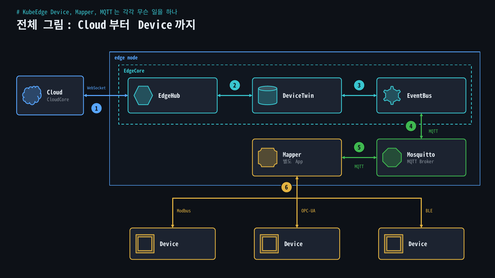
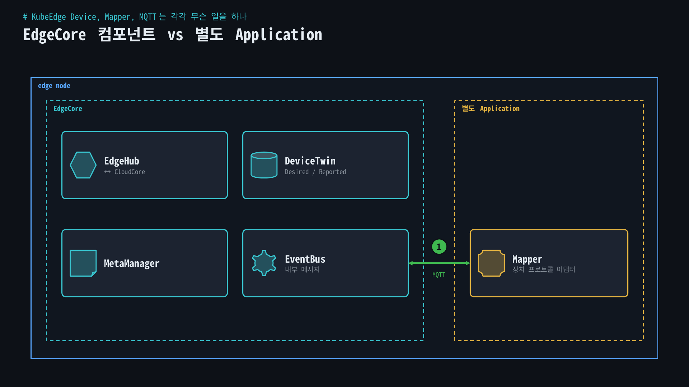
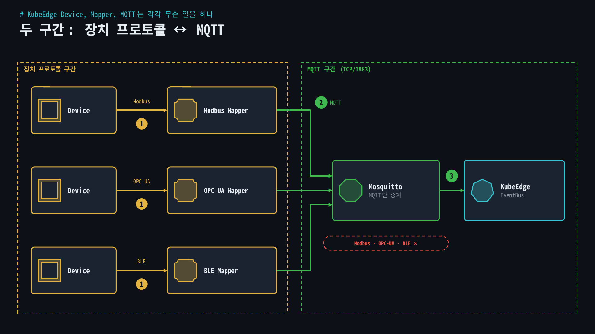
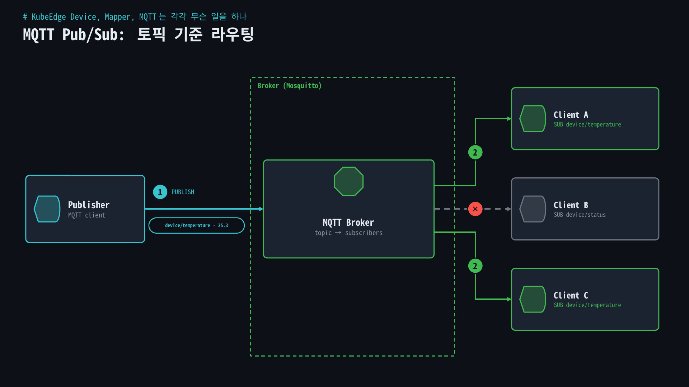
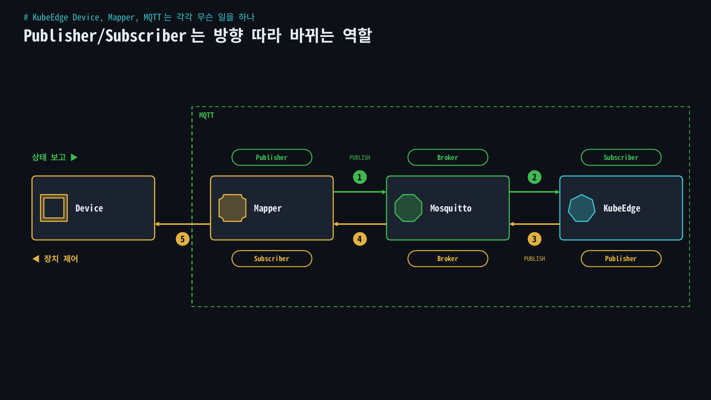
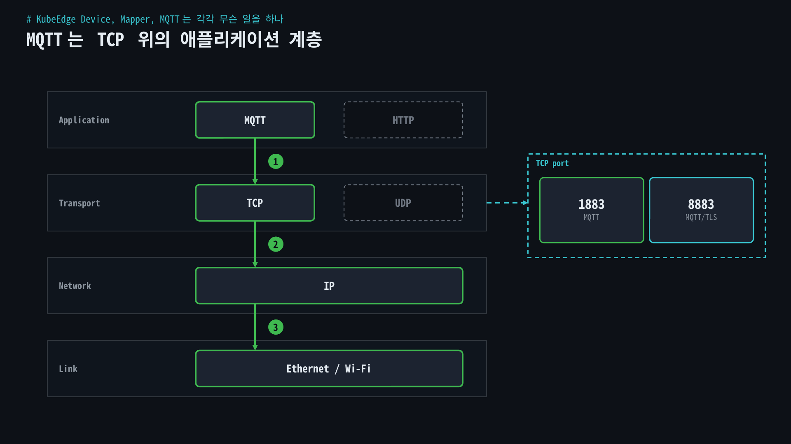
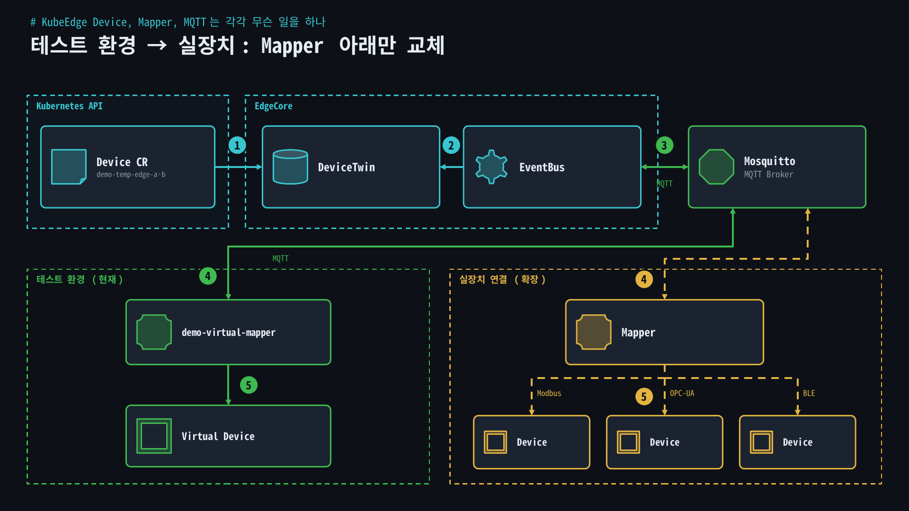
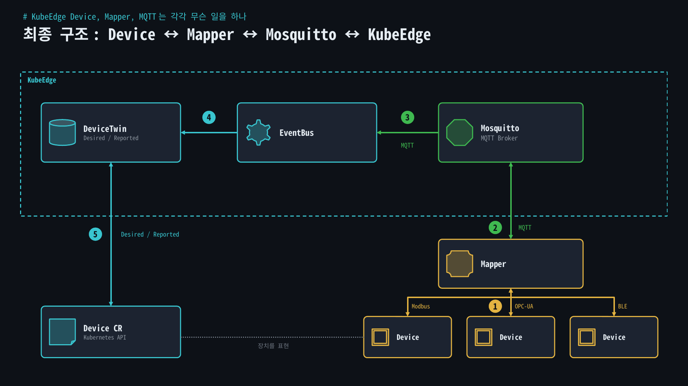

KubeEdge로 장치를 다루다 보면 Device, Mapper, EventBus, DeviceTwin, Mosquitto 같은 이름이 한꺼번에 나온다. 처음에는 누가 장치와 직접 말하고 누가 메시지만 넘기는지가 계속 헷갈렸다. 이 글에서 구조를 한 번에 정리해 둔다.

## 배경: 무엇이 헷갈렸나

헷갈린 지점은 크게 세 가지였다.

- Device 리소스가 Modbus나 OPC-UA 통신까지 직접 하는가?
- Mapper는 EdgeCore 안에 들어 있는 컴포넌트인가?
- Mosquitto가 장치 프로토콜을 처리하는가?

셋 다 답은 "아니다"였다. 핵심은 **장치와 Mapper 사이의 프로토콜**과 **Mapper와 KubeEdge 사이의 MQTT**를 따로 보는 것이다.

전체 그림은 다음과 같다.

<figure>
  <a href="/images/blog/kubeedge-device-mapper-mqtt/diagram-1.png">
    
  </a>
</figure>

## 개념

### Device: 장치를 표현하는 리소스

Device는 KubeEdge가 관리할 실제 장치를 Kubernetes 리소스로 표현한 객체다.

- 장치 정보와 속성 정의
- 장치 Desired 상태 관리
- 장치 Reported 상태 관리
- Kubernetes API로 장치 관리

Device 자체가 Modbus나 OPC-UA로 통신하지는 않는다. **장치를 표현하는 리소스**일 뿐이다.

### Mapper: 장치 프로토콜을 처리하는 어댑터

Mapper는 실제 장치와 KubeEdge 사이의 통신을 맡는 별도 애플리케이션이다. EdgeCore 내부 컴포넌트가 아니다.

<figure>
  <a href="/images/blog/kubeedge-device-mapper-mqtt/diagram-2.png">
    
  </a>
</figure>

Mapper가 하는 일은 다음과 같다.

- 실제 장치 연결
- 장치 프로토콜 처리
- 장치 데이터 Read/Write
- 장치 상태와 이벤트 수집
- KubeEdge Device와 실제 장치 사이의 데이터 연계

그래서 장치 종류나 통신 방식에 맞는 Mapper를 골라 쓰거나 직접 만들면 된다. 한 줄로 줄이면 **Mapper는 장치별 통신 방식을 처리하는 어댑터**다.

### 장치와 Mapper 사이의 프로토콜

장치 쪽은 다양한 프로토콜을 쓴다.

**Modbus**: PLC, 센서, 계측기 같은 산업 장비에서 널리 쓰는 프로토콜이다. RS-485 같은 시리얼 기반의 Modbus RTU와 TCP/IP 기반의 Modbus TCP가 있다.

<figure>
  <a href="/images/blog/kubeedge-device-mapper-mqtt/diagram-3.png">
    
  </a>
</figure>

**OPC-UA**: 산업 자동화 환경에서 장치 데이터를 표준화해서 주고받기 위한 표준이다. Modbus보다 구조화된 데이터와 정보 모델을 표현하는 데 적합하다.

**BLE**: Bluetooth Low Energy, 저전력 근거리 무선 통신이다. 배터리로 도는 센서나 소형 IoT 장치에 주로 쓴다.

### MQTT와 Broker

MQTT(Message Queuing Telemetry Transport)는 Pub/Sub 방식으로 메시지를 전달하는 애플리케이션 계층 프로토콜이다.

<figure>
  <a href="/images/blog/kubeedge-device-mapper-mqtt/diagram-4.png">
    
  </a>
</figure>

- **Publisher**: 토픽에 메시지를 발행하는 클라이언트 역할
- **Subscriber**: 관심 있는 토픽을 구독하는 클라이언트 역할
- **Broker**: 받은 메시지를 토픽과 구독 정보에 따라 맞는 클라이언트에게 전달하는 중계 서버

Broker는 메시지를 무조건 뿌리지 않는다. 다음처럼 구독이 걸려 있다고 하자.

여기에 `device/temperature`로 메시지가 들어오면, Broker는 그 토픽을 구독한 클라이언트에게만 보낸다.

Broker가 맡는 일을 모으면 이렇다.

- MQTT 클라이언트 연결 관리
- 토픽 구독 정보 관리
- Publish 메시지 수신
- 토픽 기반 메시지 라우팅
- 구독자에게 메시지 전달
- QoS 처리
- 인증과 접근 제어
- MQTT 세션 관리

### Mosquitto: MQTT Broker 구현체

Mosquitto는 MQTT Broker의 구현체다. 그러니 Mosquitto가 Modbus, OPC-UA, BLE를 직접 처리하지 않는다.


Mosquitto는 MQTT 클라이언트가 보낸 메시지를 받아 토픽에 따라 필요한 클라이언트에게 넘겨줄 뿐이다.

### Publisher와 Subscriber는 역할이다

Publisher와 Subscriber는 고정된 프로그램이 아니라 MQTT 클라이언트가 맡는 역할이다. 한 클라이언트가 두 역할을 동시에 할 수도 있고, 메시지 방향에 따라 역할이 바뀐다.

장치 상태를 보고할 때는 Mapper가 발행한다.

<figure>
  <a href="/images/blog/kubeedge-device-mapper-mqtt/diagram-5.png">
    
  </a>
</figure>

장치를 제어할 때는 반대로 KubeEdge가 발행한다.

### MQTT는 TCP를 대체하지 않는다

MQTT는 TCP, UDP와 같은 계층이 아니다. HTTP처럼 애플리케이션 계층에 있고, 보통 TCP 위에서 동작한다.

<figure>
  <a href="/images/blog/kubeedge-device-mapper-mqtt/diagram-6.png">
    
  </a>
</figure>

| 프로토콜 | 역할 |
| --- | --- |
| TCP | 신뢰성 있는 전송 |
| UDP | 비연결형 데이터 전송 |
| HTTP | Request/Response 기반 애플리케이션 통신 |
| MQTT | Publish/Subscribe 기반 메시징 |

TCP가 데이터를 실어 나르는 기반을 주고, MQTT는 그 연결 위에서 메시지와 Pub/Sub 동작을 정의한다. 대표 포트는 다음과 같다.


## 실습: 테스트 환경 구조

테스트 환경에는 실제 센서나 산업 장비 대신, 가상 장치를 대상으로 동작하는 테스트용 Mapper(`demo-virtual-mapper`)를 붙였다.

<figure>
  <a href="/images/blog/kubeedge-device-mapper-mqtt/diagram-7.png">
    
  </a>
</figure>

실제 장치를 연결하게 되면 Mapper 아래쪽만 바꿔서 다음처럼 확장하면 된다.


## 검증

Device 리소스가 Kubernetes API로 보이는지 확인했다. (장치 이름은 예시로 바꿨다.)

```bash
kubectl get devices -A
NAMESPACE   NAME                AGE
default     demo-temp-edge-a    16h
default     demo-temp-edge-b    16h
```

테스트용 Device 두 개가 Kubernetes 리소스로 등록돼 있다. 장치가 Kubernetes 리소스로 관리된다는 것, 그 아래의 실제 통신은 Mapper와 MQTT가 맡는다는 것이 이 구조의 핵심이다.

## 정리

| 구성요소 | 핵심 역할 |
| --- | --- |
| Device | KubeEdge에서 관리할 장치를 표현하는 리소스 |
| Mapper | 실제 장치의 통신 프로토콜을 처리하는 별도 애플리케이션 |
| Modbus | 산업 장비와 통신하기 위한 프로토콜 |
| OPC-UA | 산업 장비의 구조화된 데이터 교환을 위한 표준 |
| BLE | 저전력 근거리 무선 통신 기술 |
| MQTT | Pub/Sub 방식의 메시징 프로토콜 |
| Publisher | MQTT 메시지를 발행하는 클라이언트 역할 |
| Subscriber | MQTT 메시지를 구독하는 클라이언트 역할 |
| Broker | MQTT 메시지를 중개·라우팅하는 서버 |
| Mosquitto | MQTT Broker 구현체 |
| EventBus | EdgeCore 내부 메시지 전달 |
| DeviceTwin | Device의 Desired/Reported 상태 관리 |
| EdgeHub | Edge와 CloudCore 간 통신 |

최종 구조는 이렇게 이해하면 된다.

<figure>
  <a href="/images/blog/kubeedge-device-mapper-mqtt/diagram-8.png">
    
  </a>
</figure>

한 문장으로 줄이면 이렇다.

> 실제 장치는 Modbus·OPC-UA·BLE 같은 방식으로 Mapper와 통신하고, Mapper는 MQTT Publisher/Subscriber로 Mosquitto Broker와 메시지를 주고받는다. Mosquitto는 토픽을 기준으로 메시지를 중계해서 KubeEdge의 EventBus·DeviceTwin과 장치 데이터를 잇는다.

이 구조에 실제로 값을 흘려 본 결과는 [DeviceTwin·MQTT 시험](/blog/kubeedge-devicetwin-mqtt-test/)에 정리했다.
