Chrome 창이 뜨고, 음악이 흐르고, 마우스가 움직이고, 다운로드가 진행된다. 모두 동시에 일어나는 것처럼 보이지만 뒤에서는 **운영체제(OS)** 하나가 CPU 시간·메모리·장치를 나눠 주며 전부를 조율한다.

> 아래 그림은 Study 폴더의 슬라이드를 이미지로 옮긴 것이다.

## 한눈에 보는 구조

위에는 앱, 아래에는 하드웨어, 가운데에 OS(스케줄러·메모리·파일·네트워크)가 있다.

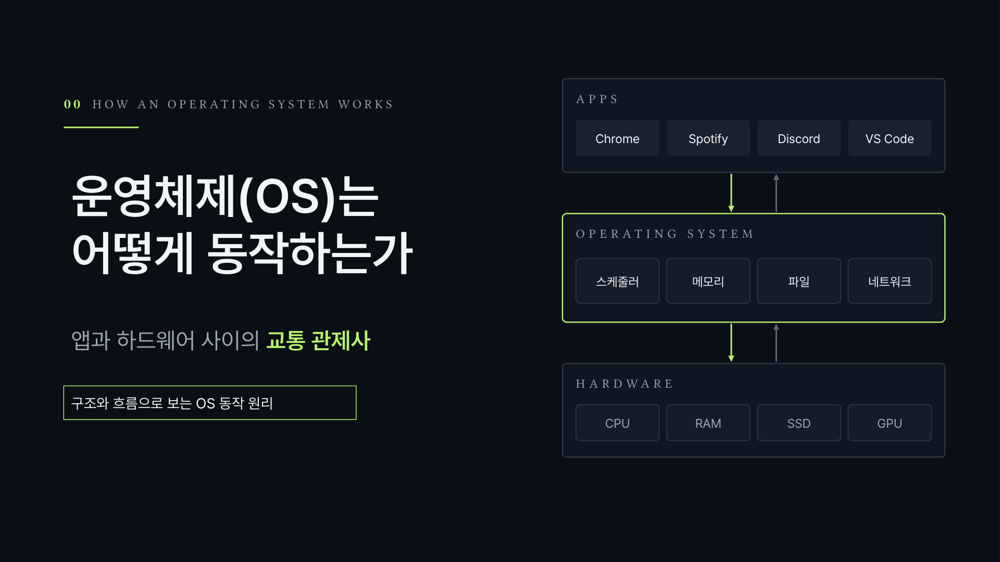

## 겉으로 보이는 것

여러 일이 동시에 도는 것처럼 보이지만, 실제로는 CPU가 아주 짧은 시간 단위로 번갈아 처리하고 누가 언제 무엇을 쓸지는 OS가 정한다.

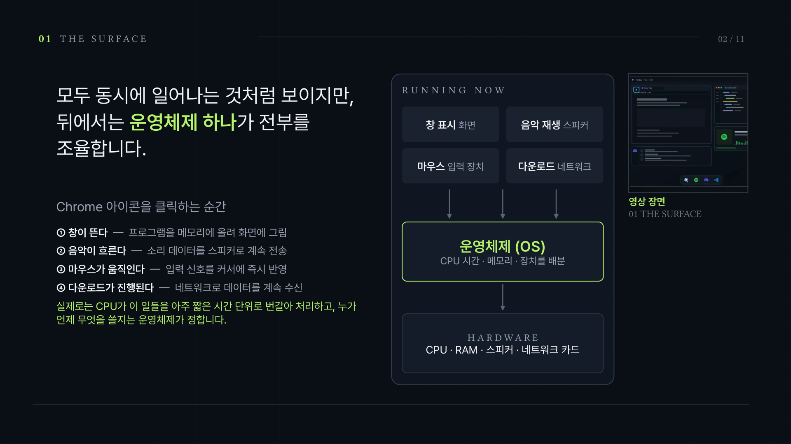

## 3계층 구조: 요청은 내려가고 결과는 올라온다

앱은 하드웨어를 직접 만지지 않는다. Chrome이 파일을 읽고 싶으면 OS에 요청하고, OS가 SSD를 제어해 가져온 뒤 결과를 돌려준다. 덕분에 앱은 하드웨어 종류를 몰라도 되고, 여러 앱이 같은 하드웨어를 안전하게 나눠 쓴다.

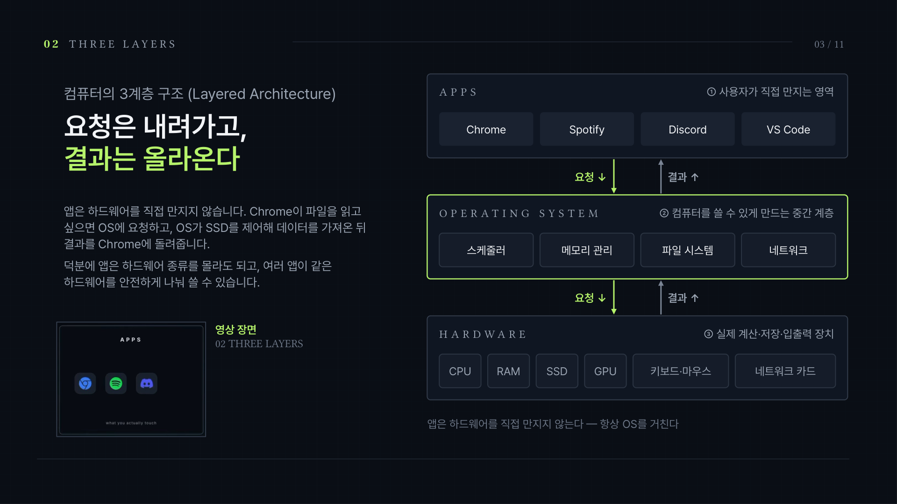

## CPU와 스케줄러

실행 준비가 된 앱은 Ready Queue에서 기다린다. 코어 하나는 한 번에 하나만 실행하므로, 스케줄러가 다음 앱을 골라 짧은 시간 조각(Time Slice)을 주고, 끝나면 상태를 저장한 뒤 다음 앱으로 전환(Context Switch)한다. 한 칸이 수 밀리초라 동시에 도는 것처럼 보인다.

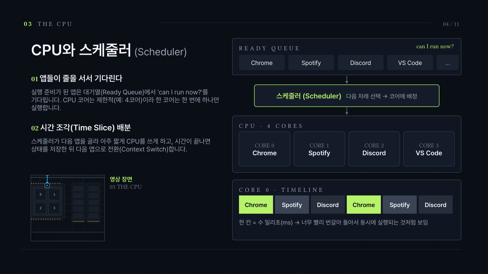

## 메모리와 가상 메모리

프로세스마다 0번지부터 시작하는 가상 주소 공간을 주고, 페이지 테이블로 각 페이지를 실제 RAM 프레임에 연결한다. 주소 변환은 CPU의 MMU가 하고, 남의 프레임 접근은 OS가 막는다.

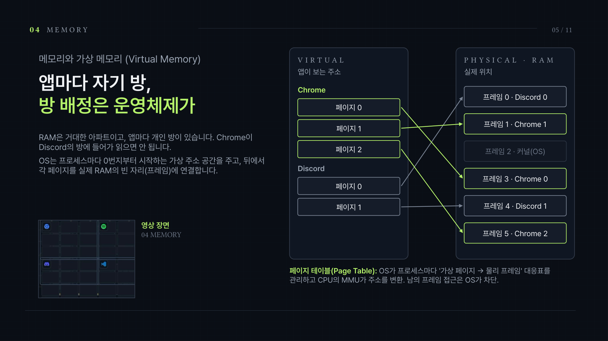

## 시스템 콜

파일·네트워크·화면이 필요하면 앱은 OS의 정해진 창구, 시스템 콜(예: `open()`)로 요청한다. 커널 모드의 OS가 권한, 파일 위치, 저장장치 영역을 확인한 뒤 드라이버로 넘긴다. 앱이 SSD에 직접 접근하는 길은 막혀 있다.

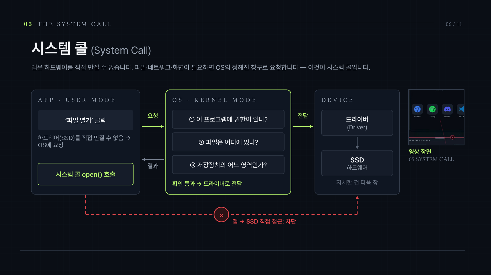

## 디바이스 드라이버

드라이버는 번역기다. OS의 공통 요청("이 데이터 읽어")을 각 장치가 알아듣는 바이트 명령으로 바꾸고, 완료(인터럽트)를 다시 OS에 돌려준다. 키보드·마우스·GPU·Wi-Fi마다 전용 드라이버가 같은 방식으로 일한다.

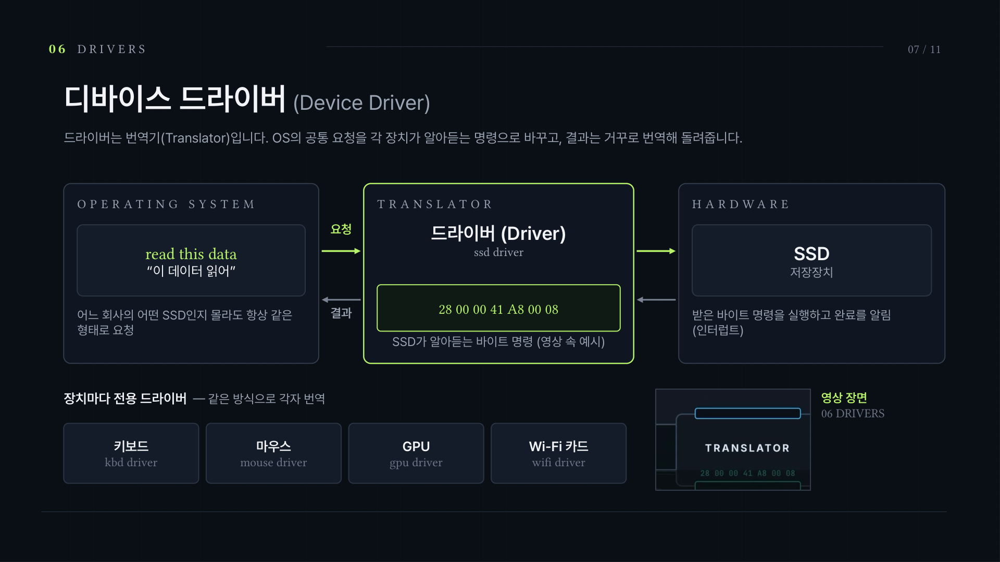

## 네트워크 스택

웹사이트를 열면 데이터는 Socket → TCP/UDP → IP → Link → NIC 순서로 내려가 전송되고, 응답은 거꾸로 올라온다. TCP는 순서·재전송을 보장하고, UDP는 빠름을 택한다.

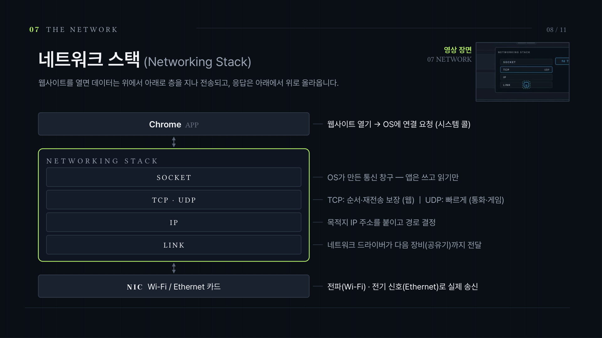

## 커널과 ring 0

특권 접근(ring 0)은 커널만 가진다. 일반 앱은 사용자 모드(ring 3)에서 돌며 시스템 콜로만 요청한다. 그래서 앱 하나가 멈춰도 그 앱만 종료되고 OS와 다른 앱은 계속 동작한다.

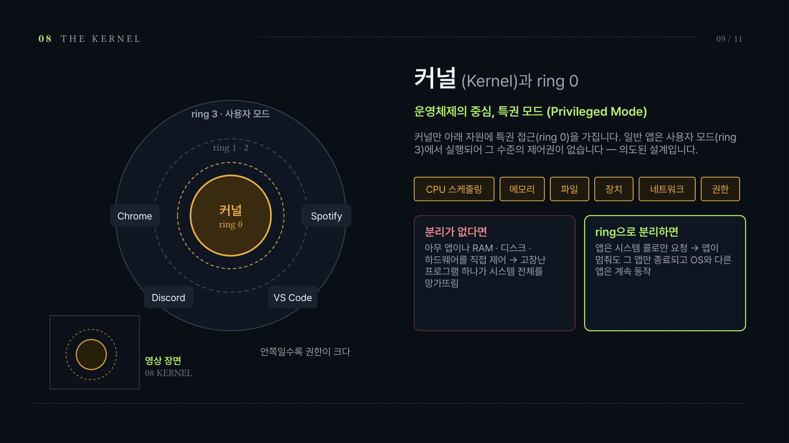

## 전체 그림

요청은 앱 → OS → 하드웨어로 내려가고 결과는 거꾸로 올라온다. OS는 요청마다 누가, 무엇을, 언제, 허용할지 판단한다. 데스크톱 화면이 아니라 컴퓨터 전체 아래에서 도는 교통 관제사다.

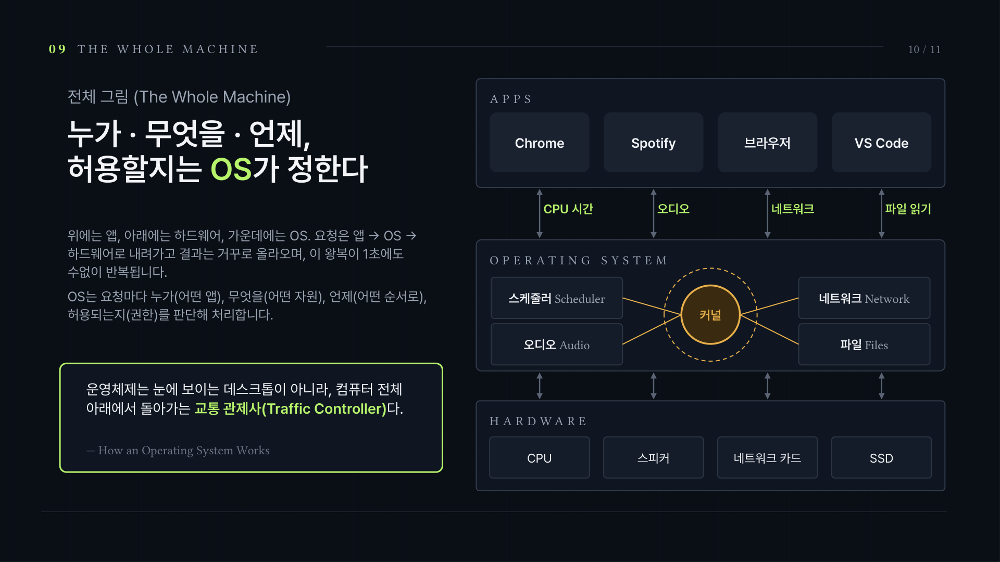

## 정리

스케줄러, 가상 메모리, 시스템 콜, 디바이스 드라이버, 네트워크 스택, 커널(ring 0). 앱과 하드웨어 사이에서 OS가 일하는 여섯 가지 방식이다.

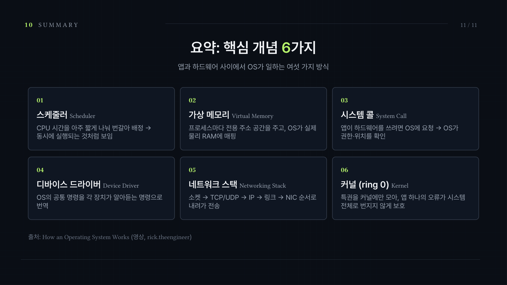

출처: How an Operating System Works (영상, rick.theengineer)
