Jake가 시애틀의 Olivia에게 셀카 한 장을 보낸다. 탭 한 번, 약 1초. 그 사이 사진은 **OSI 7계층**을 내려갔다가 선을 건너 다시 올라간다.

> 아래 그림은 Study 폴더의 [OSI_7계층.pptx](/files/OSI_7계층.pptx) 슬라이드다. 원본 덱도 같은 링크로 받을 수 있다. 이어지는 실전편은 [OSI 관점 KubeEdge AI 데이터 전송: PDU와 MTU/MSS](/blog/osi-ip-packet-mtu/) 에 있다.

## 개요

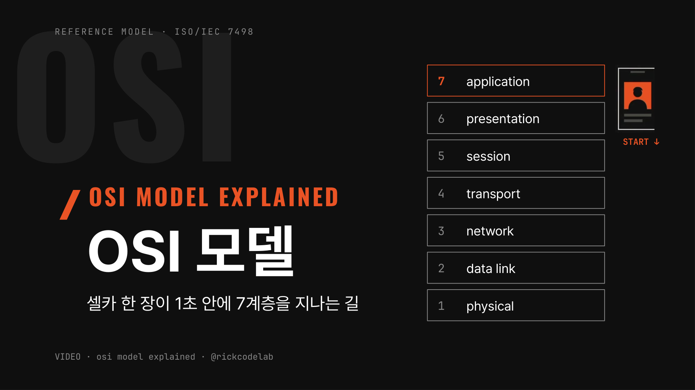

보내는 쪽은 7→1로 내려가며 포장하고, 선을 건너, 받는 쪽은 1→7로 올라가며 푼다.

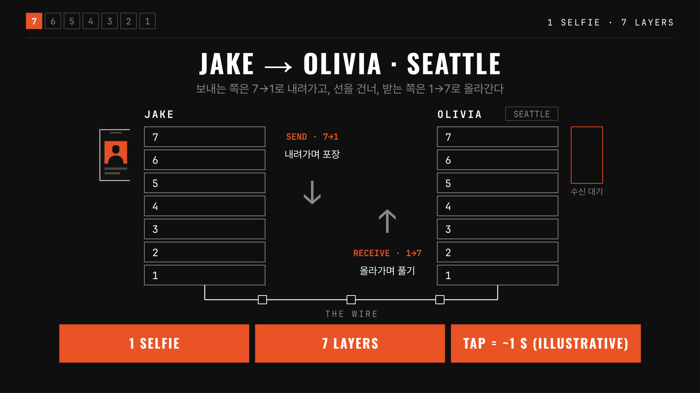

ISO/IEC 7498 참조 모델의 일곱 층과 각자의 역할이다. 영상처럼 7부터 시작한다.

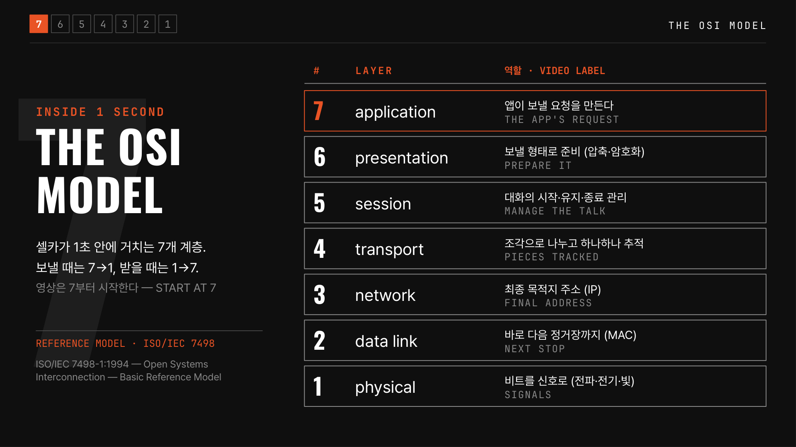

## 7 Application: 앱의 요청

앱이 "이 사진을 Olivia에게 보내라"는 요청을 만든다. HTTP는 페이지를 요청하는 규칙, DNS는 이름을 IP 주소로 바꾸는 규칙이다.

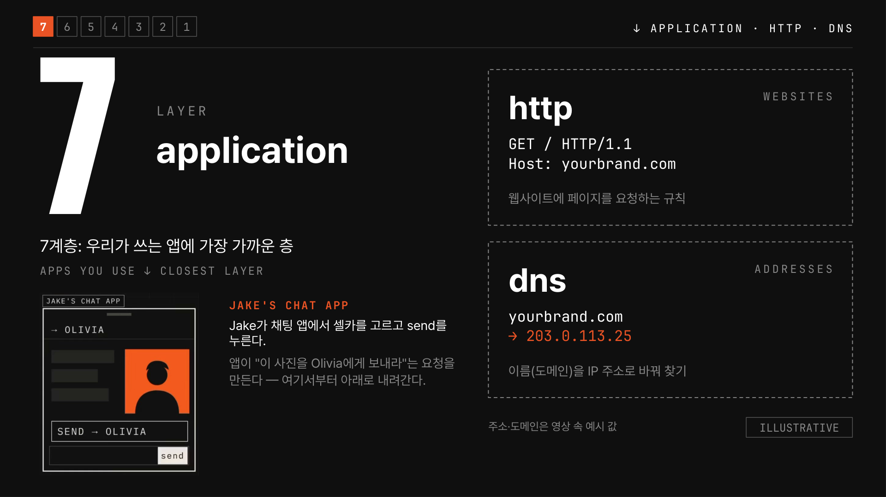

## 6 Presentation: 포장과 보호

떠나기 전에 압축하고 암호화한다. 중간에서 가로채도 의미 없는 무늬만 보이고, 받는 쪽 6계층이 다시 원래 사진으로 되돌린다.

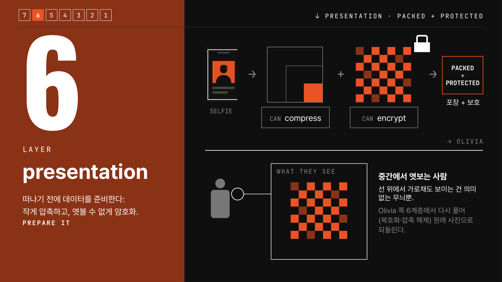

## 5 Session: 대화 관리

연결을 수립하고(established), 데이터가 오가는 동안 유지하고(maintained), 끝나면 닫는다(ended).

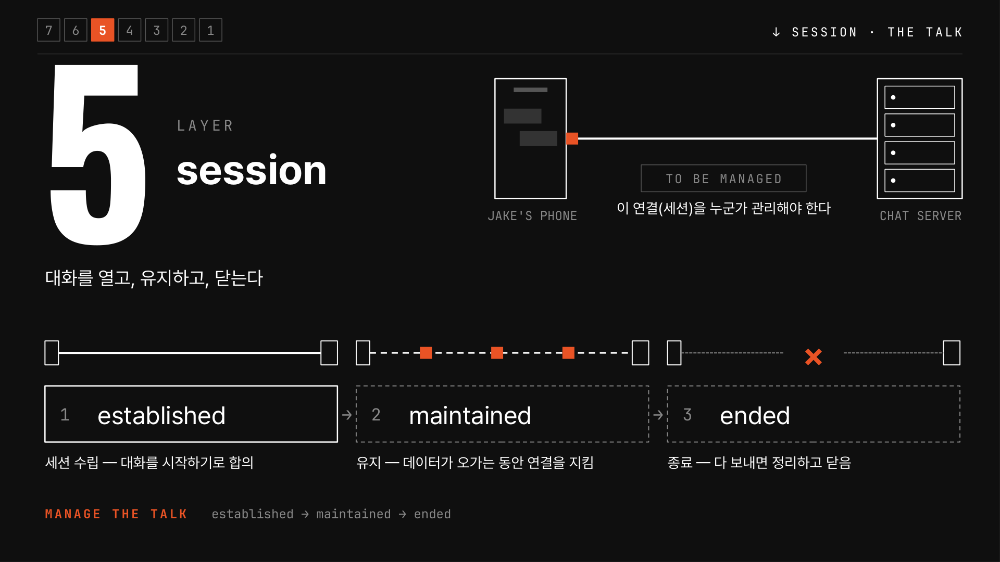

## 4 Transport: 조각과 추적

사진이 너무 크면 조각으로 나누고 하나하나 추적한다. TCP는 빠진 조각을 다시 받아 전부 와야 완성하고, UDP는 실시간 영상처럼 빈칸을 건너뛰고 계속 간다.

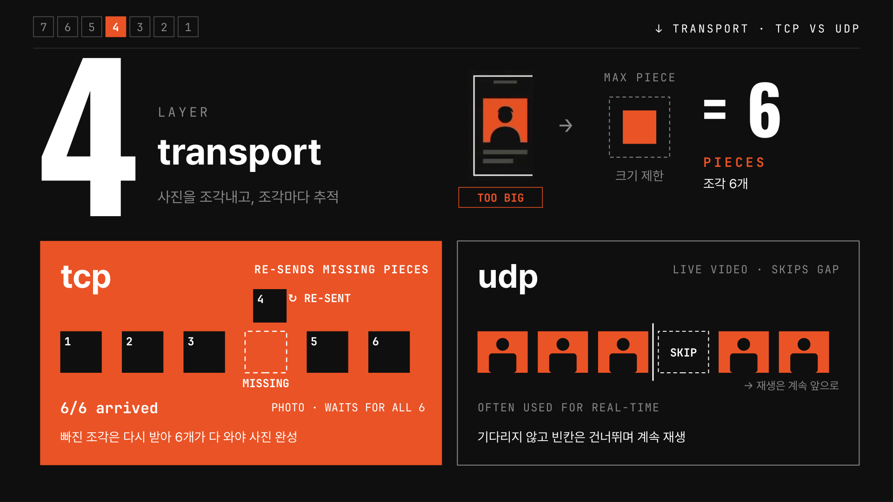

## 3 Network: 최종 주소

조각마다 출발지·목적지 IP를 붙인다. 라우터는 목적지 주소만 읽고 다음 홉을 고른다.

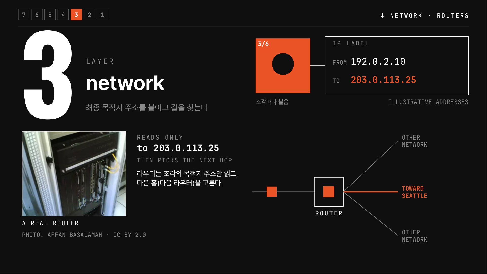

## 2 Data Link: 다음 정거장

바로 다음 장비까지 MAC 주소로 전달한다. MAC 라벨은 홉마다 바뀌고, IP 목적지는 끝까지 그대로다.

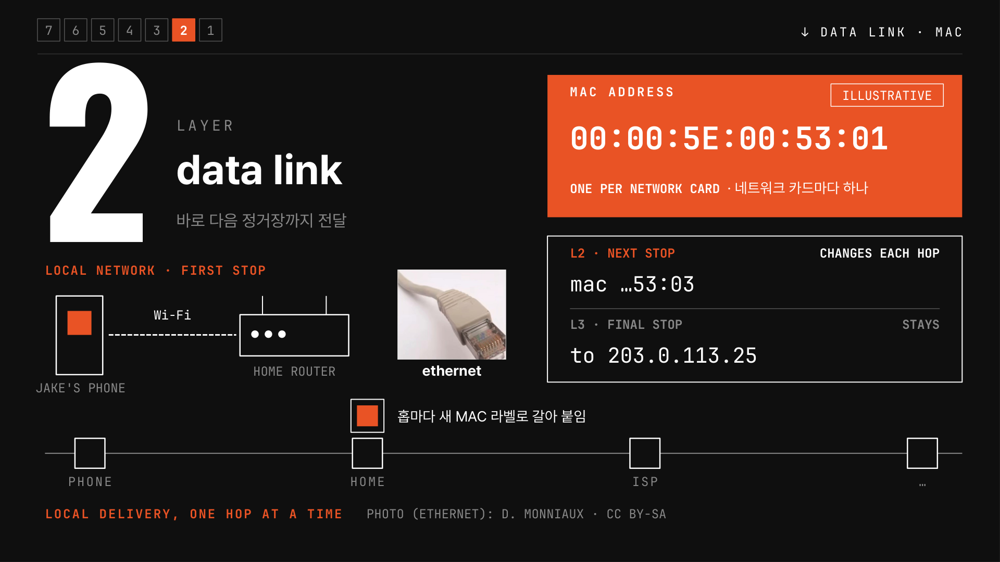

## 1 Physical: 신호

사진은 결국 0과 1의 줄이다. 1계층은 이를 전파(Wi-Fi), 전기(구리선), 빛(광섬유) 신호로 바꾼다.

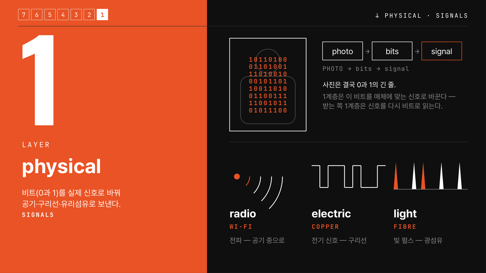

## 캡슐화

내려갈 때 층마다 라벨을 한 겹씩 덧붙인다: data → segment(TCP) → packet(IP) → frame(MAC·FCS) → bits. 라우터는 바깥 라벨만 보고 한 홉씩 넘긴다.

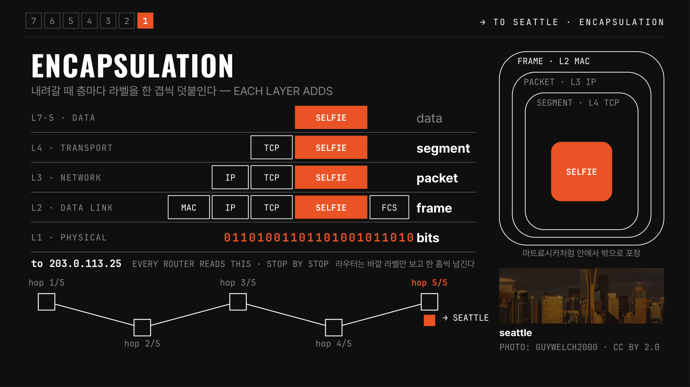

## 받는 쪽, 그리고 고장 난 곳 찾기

Olivia 쪽에서는 1→7로 올라가며 풀어 사진이 화면에 뜬다. 안 갔다면 아래(1)부터 한 층씩 올라가며 확인한다: 신호 → 공유기 → 목적지 경로 → 조각 손실 → 앱·서버.

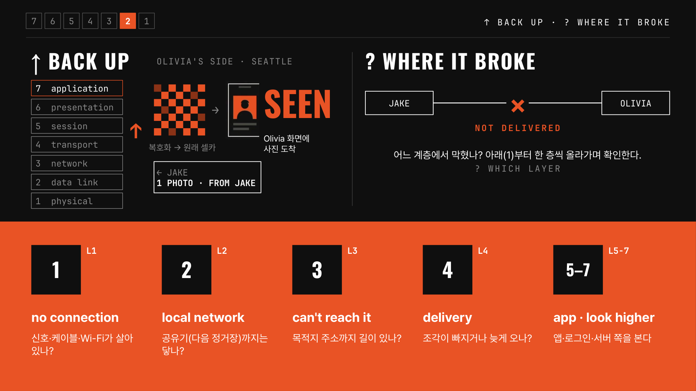

## OSI 7 vs TCP/IP 4

실제 인터넷은 TCP/IP 4계층(application · transport · internet · link)으로 동작한다. OSI는 여전히 문제를 나눠 보는 지도다.

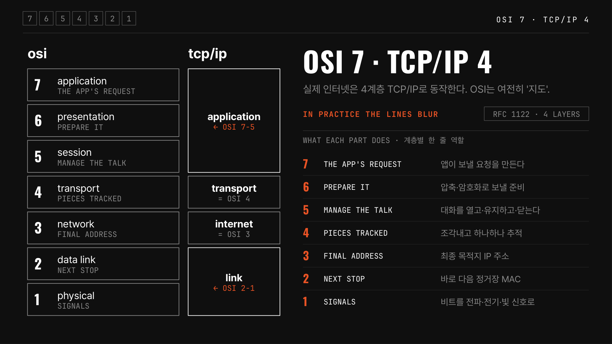

## 정리

보낼 땐 7→1 포장, 받을 땐 1→7 풀기. 계층마다 맡은 일은 하나씩. 고장 나면 아래부터 확인. 받는 사람을 잘못 고른 실수는 어느 계층도 못 막는 "8계층"이다.

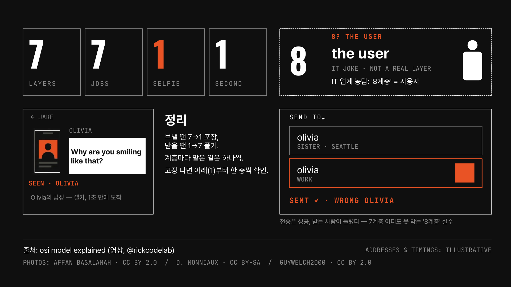

원본 슬라이드: [OSI_7계층.pptx](/files/OSI_7계층.pptx) · 출처: osi model explained (영상, @rickcodelab)
