[OSI 7계층 기초편](/blog/osi-7-layers/)을 KubeEdge 현장에 대입한 실전편이다. Edge Pod의 AI·DIL 데이터가 Cloud collector까지 갈 때 계층마다 **PDU 이름**이 바뀌고, **MTU/MSS**에 따라 몇 조각으로 나뉘는지를 본다.

> 아래 그림은 Study 폴더의 [OSI7-IP패킷-MTU.pptx](/files/OSI7-IP패킷-MTU.pptx) 슬라이드다. 원본 덱도 같은 링크로 받을 수 있다.

## 개요

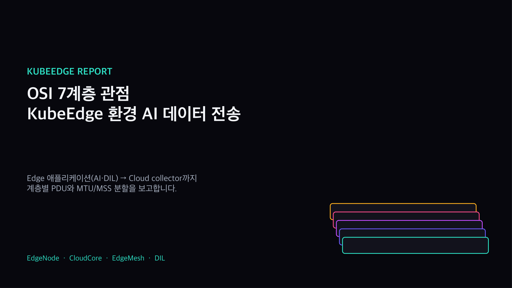

## 계층별 PDU

L4는 Segment(UDP는 Datagram), L3는 Packet, L2는 Frame, L1은 Bit다. 선로까지 가는 핵심은 L4·L3·L2다.

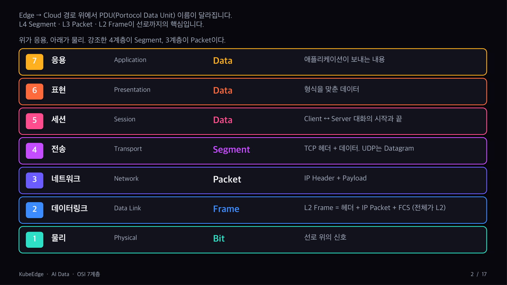

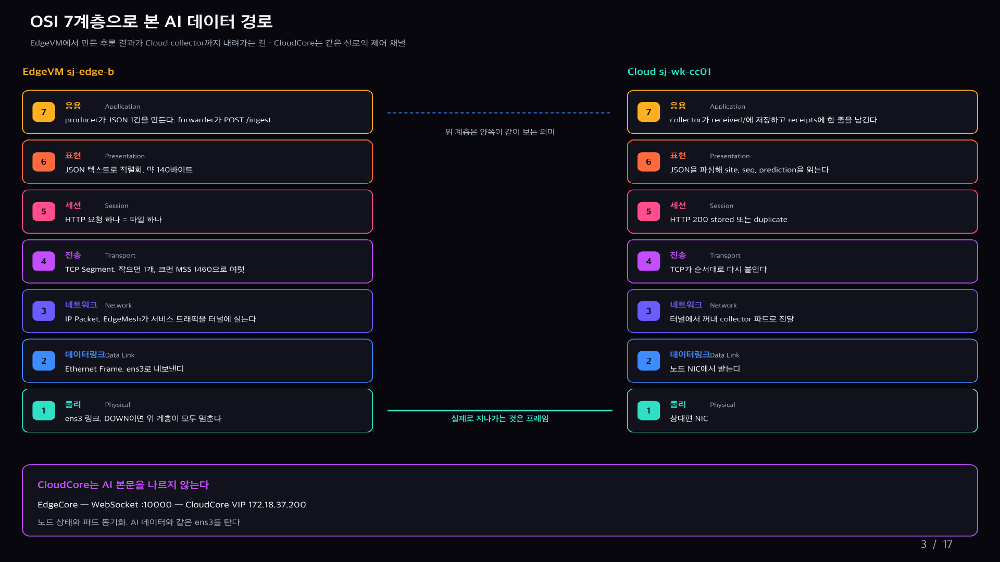

## 한 프레임 안에 든 것

바깥에서 안으로: 이더넷 헤더(14B) · IP Header(20B) · TCP Header(20B) · Data(MSS 1460B) · FCS(4B). **MTU는 IP Header부터 TCP Data까지**만 잰다. 14B·FCS는 MTU 밖이다.

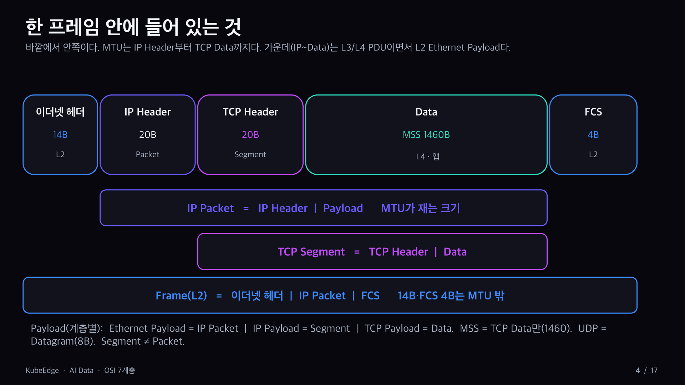

## IP Packet = IP Header + Payload

옵션 없는 IPv4 헤더는 20바이트이고 MTU 안에 들어간다. Total Length, DF 플래그(1이면 라우터가 쪼개지 않음), Protocol(TCP 6 / UDP 17)이 핵심 필드다.

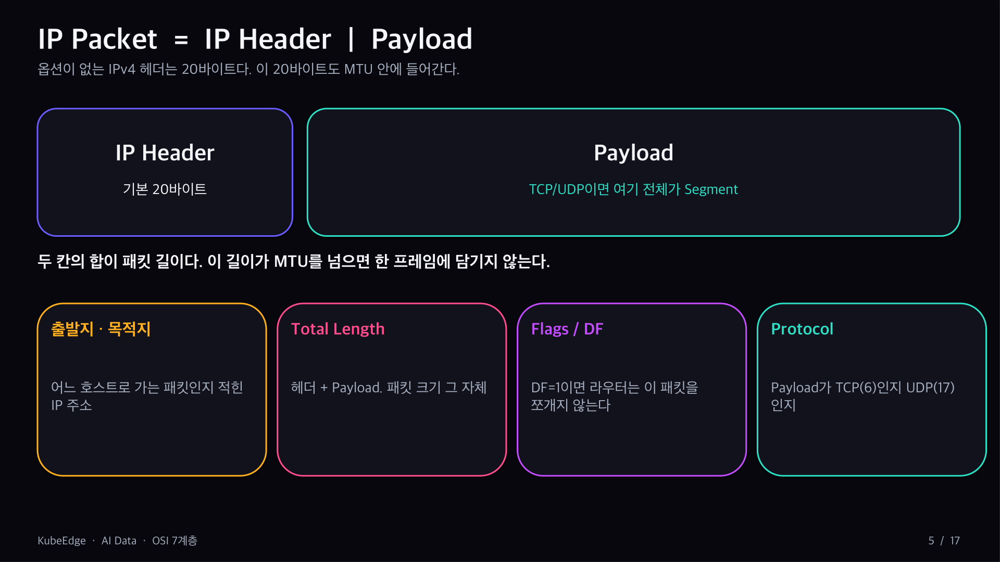

## TCP Data는 바이트 스트림

HTTP, gRPC, TLS Record, AI 데이터가 TCP Data에 실리지만 TCP는 의미를 모른다. `write()` 한 번이나 요청 하나가 Segment 하나라는 보장은 없다.

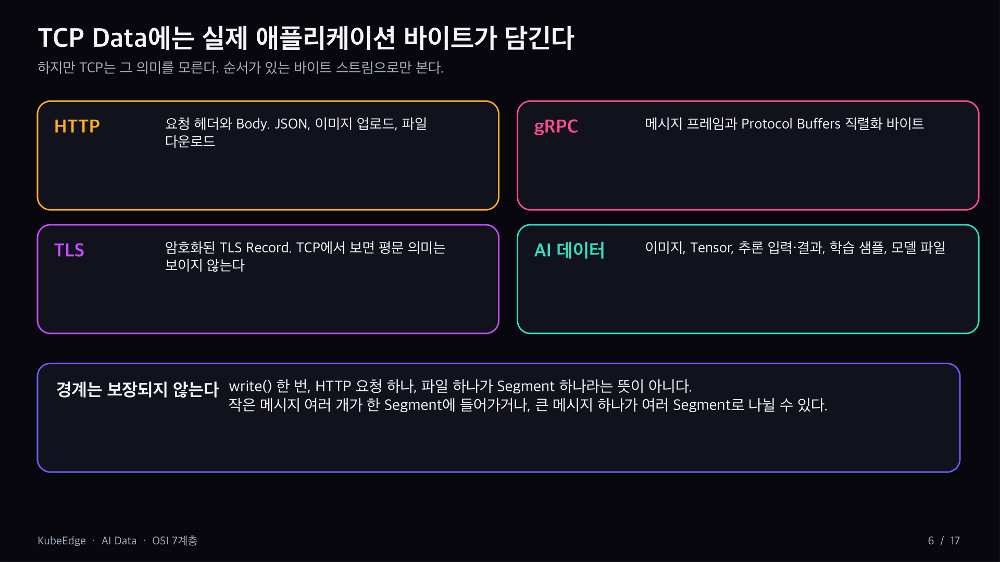

## MSS = MTU − 헤더

1500 − 20(IP) − 20(TCP) = **1460**. IPv6면 1440, TCP 타임스탬프 옵션이 붙으면 약 1448, UDP는 1500 − 20 − 8 = 1472.

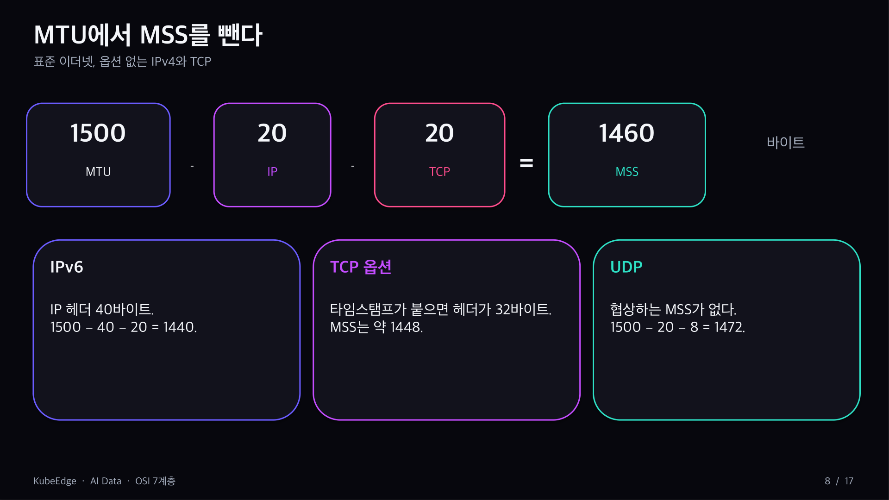

## 큰 데이터도 MSS 단위로

10KB AI 데이터는 1460 × 6 + 1240, 즉 Segment 7개가 된다. 자르는 건 애플리케이션이 아니라 TCP이고, 받는 TCP가 순서대로 다시 붙인다.

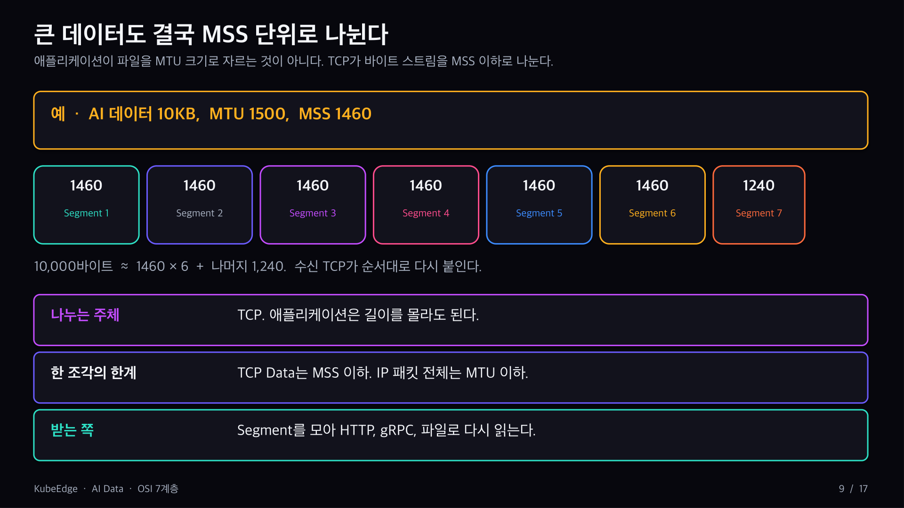

## Edge AI 데이터의 하강 경로

AI 데이터 → HTTP·gRPC·TLS → TCP 바이트 스트림 → Segment(≤MSS) → IP Packet(≤MTU) → Ethernet Frame. 메시지 경계와 Segment 경계는 다르다.

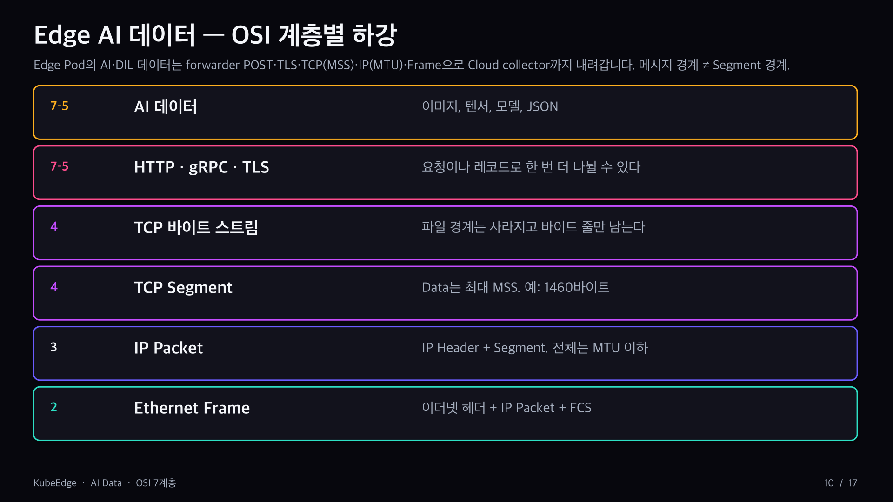

## 크기에 따라 조각 수가 달라진다

약 140바이트 DIL JSON은 Segment 하나로 끝나고, 수 MB 이미지·텐서·모델은 수천 개가 된다. 서버 캡처에서는 TSO/GSO 때문에 MTU보다 큰 덩어리가 보이고, VXLAN 같은 오버레이는 실효 MTU를 줄인다.

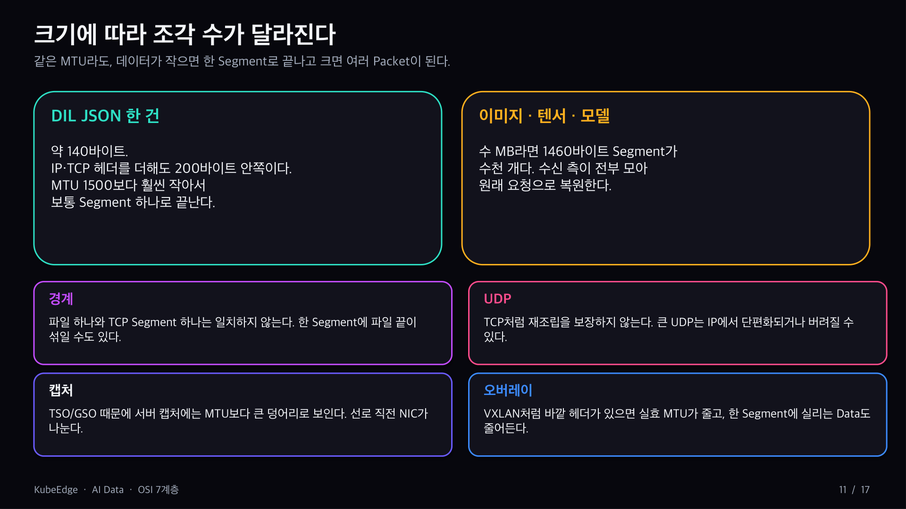

## 연결이 유지되면 차이는 시간

경로가 끊기지 않으면 큰 파일도 순서대로 도착해 원래 요청으로 복원된다. 체감 차이는 전송 시간이다.

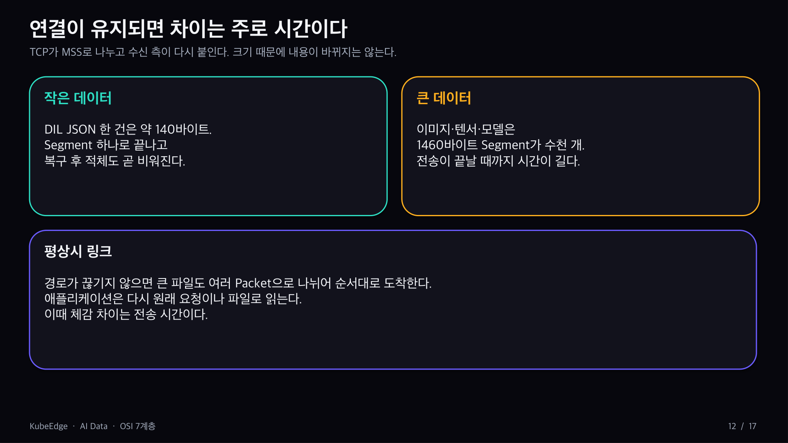

## 작은 JSON vs 큰 학습 데이터

단절 중 쌓이는 양, 복구 후 비우는 시간, 한 번의 POST가 8초 안에 끝나는지, 파드 축출 전에 비울 수 있는지가 갈린다.

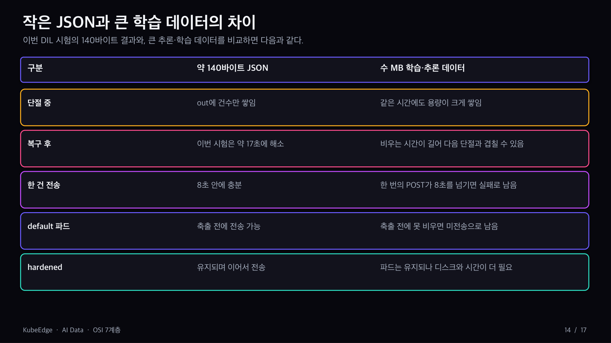

## MQTT도 L7 프로토콜

MQTT는 브로커 중심 Pub/Sub이다. Topic·QoS·Payload는 L7에서만 해석되고, TCP는 MQTT 메시지 경계를 모른다. 유선·무선은 Link 계층 선택일 뿐이다.

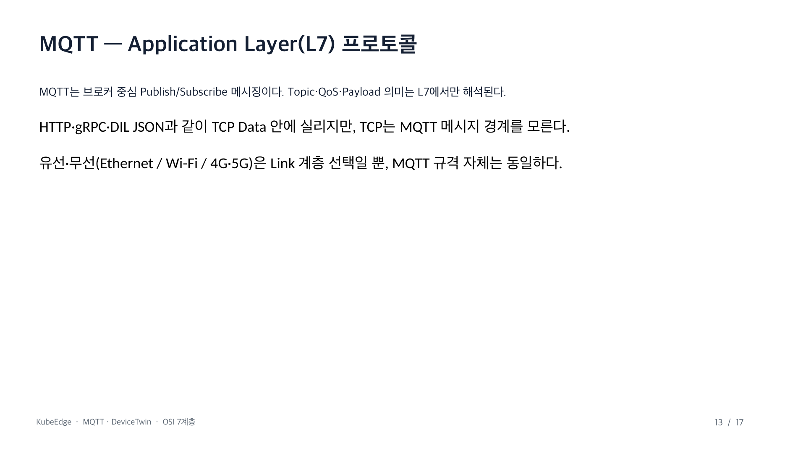

DeviceTwin `twin/update` JSON(수백 바이트)은 MSS 1460보다 작아 보통 Segment 1~2개면 된다. 큰 Payload는 HTTP처럼 여러 Segment로 나뉜다.

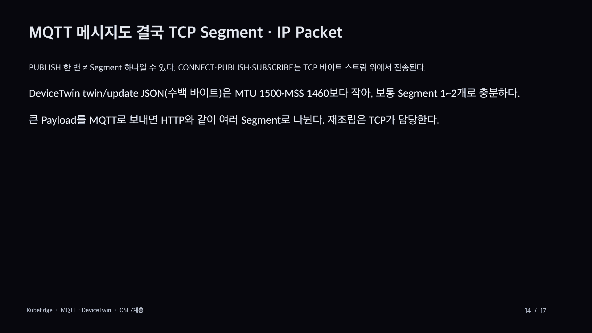

## KubeEdge Edge의 MQTT 경로

tester Pod → Mosquitto(127.0.0.1:1883) → EdgeCore EventBus → DeviceTwin → CloudCore. 127.0.0.1은 "무선 MQTT"가 아니라 TCP 목적지가 loopback인 엣지 패턴이다.

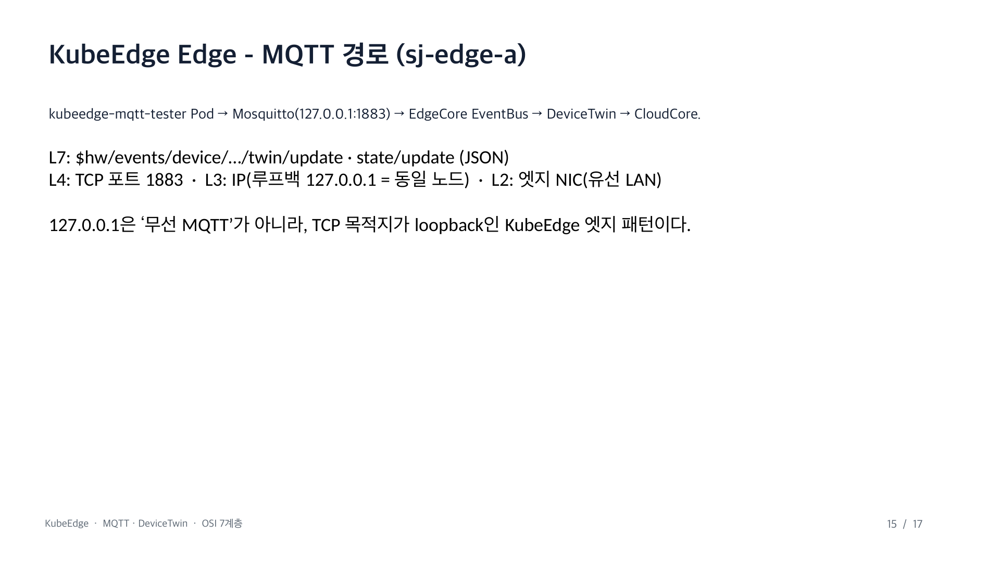

같은 MQTT라도 링크만 Ethernet이냐 Wi-Fi/4G/5G냐가 다를 뿐 계층 구조는 같다.

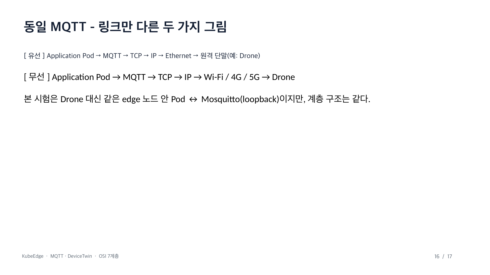

## 정리

DIL·AI forwarder는 Edge → Cloud, TLS·큰 Payload·MTU/MSS가 이슈다. DeviceTwin MQTT는 노드 내부·소형 JSON이라 분할보다 브로커·토픽·트윈 의미가 핵심이다. 공통점은 L7 바이트 → Segment → Packet → Frame.

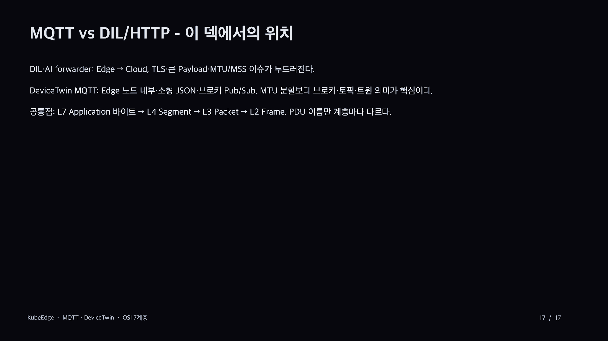

원본 슬라이드: [OSI7-IP패킷-MTU.pptx](/files/OSI7-IP패킷-MTU.pptx)
