학습 마감일 이후에 쓰인 문서, 비공개 사내 핸드북처럼 모델이 본 적 없는 내용에는 일반 챗봇이 바로 답하지 못한다. 그렇다고 600쪽을 질문마다 통째로 붙이면 컨텍스트 한도를 넘기고, 비용도 질문 수만큼 불어난다. 긴 입력의 중간에 정답이 있으면 놓치기도 쉽다.

**RAG(Retrieval-Augmented Generation)** 는 이 문제를 “먼저 찾고(Retrieval), 그다음 생성(Generation)”으로 나눈다. 문서를 작은 카드로 자르고, 질문과 뜻이 가까운 카드만 골라 프롬프트에 넣은 뒤, 그 근거 안에서만 답하게 한다.

> 아래 그림은 Study 폴더의 [RAG_동작원리.pptx](/files/RAG_동작원리.pptx) 슬라이드다. 원본 덱도 같은 링크로 받을 수 있다.

## 한눈에 보는 흐름

질문이 오면 관련 문서 조각을 먼저 찾아 프롬프트에 함께 넣고, 그 근거로 답한다. 순서는 **1 CHUNK → 2 FIND → 3 PROMPT** 이다.

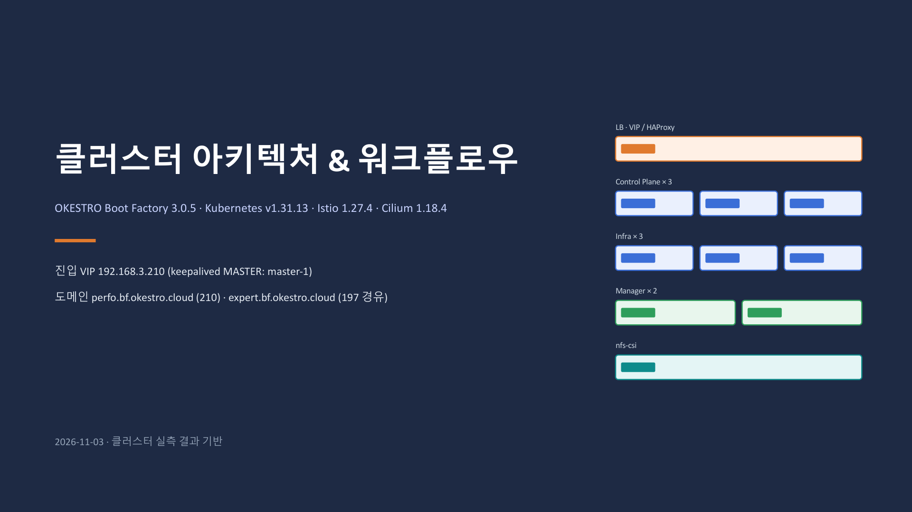

## 왜 그냥 물어보면 안 되나

사내 휴가 규정처럼 학습 데이터에 없는 600쪽 핸드북은 모델이 본 적이 없다. 학습 컷오프 이후 문서와 비공개 문서는 둘 다 같은 맹점이다.

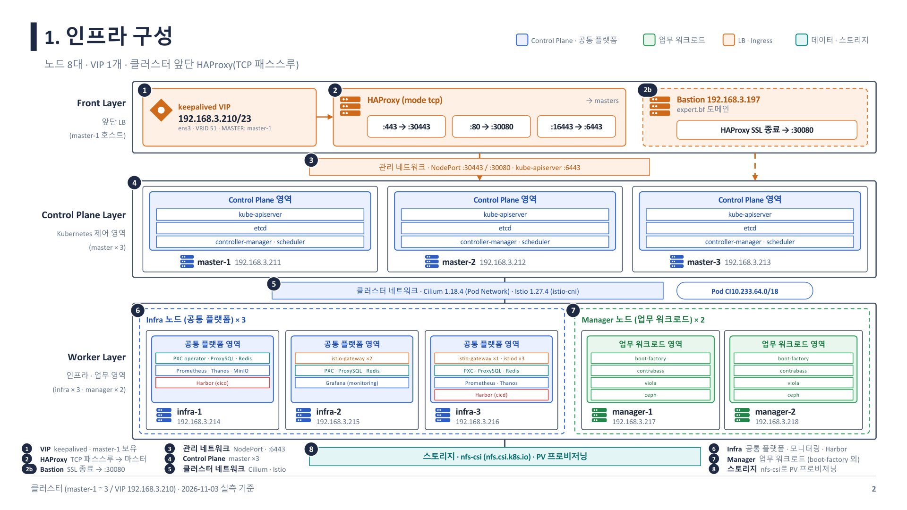

가장 단순한 우회는 600쪽 전체를 질문과 함께 붙이는 것이다. 그러면 컨텍스트 창을 넘기기 쉽고, 질문마다 전체를 다시 넣어 비용이 커진다.

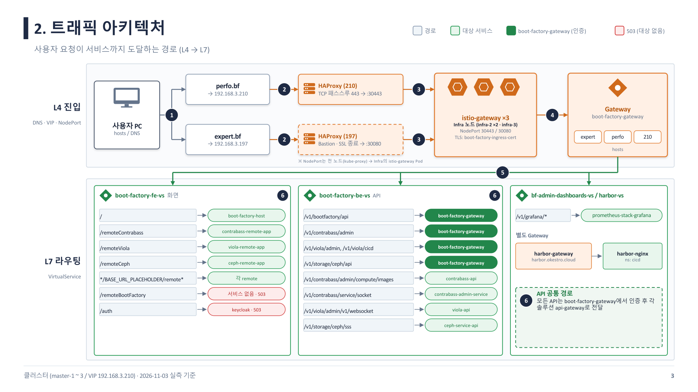

게다가 정답이 긴 입력의 **중간**에 있으면 정확도가 떨어지는 현상(lost in the middle)이 있다. 많이 넣을수록 좋은 것이 아니다.

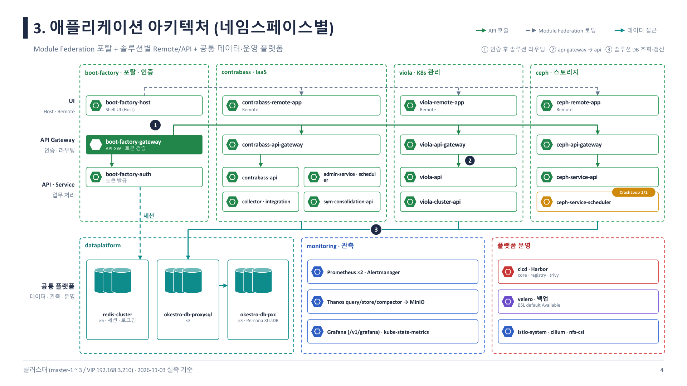

## 핵심 아이디어: 필요한 조각만

그래서 RAG는 세 단계로 나눈다. 문서를 카드로 자르고(CHUNK), 질문과 관련된 카드를 찾고(FIND), 찾은 카드만 넣어 답하게 한다(PROMPT).

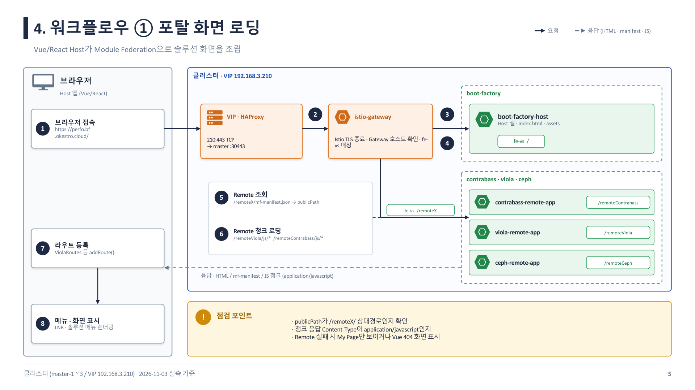

## 1단계 CHUNK: 카드를 만든다

핸드북을 문단 몇 개 분량의 작은 카드(chunk) 수천 장으로 나눈다. 이후 검색·프롬프트는 모두 이 카드 단위로 동작한다.

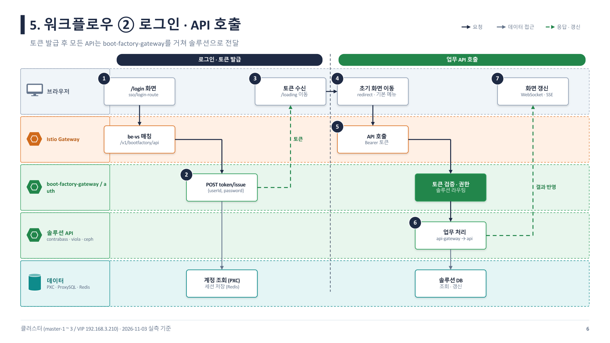

## 2단계 FIND: 키워드가 아니라 뜻으로

같은 뜻이라도 단어가 다르면 키워드 검색은 놓친다. 예를 들어 “carry vacation”과 “unused paid leave rolls over”는 겹치는 말이 거의 없어도 의미가 같다.

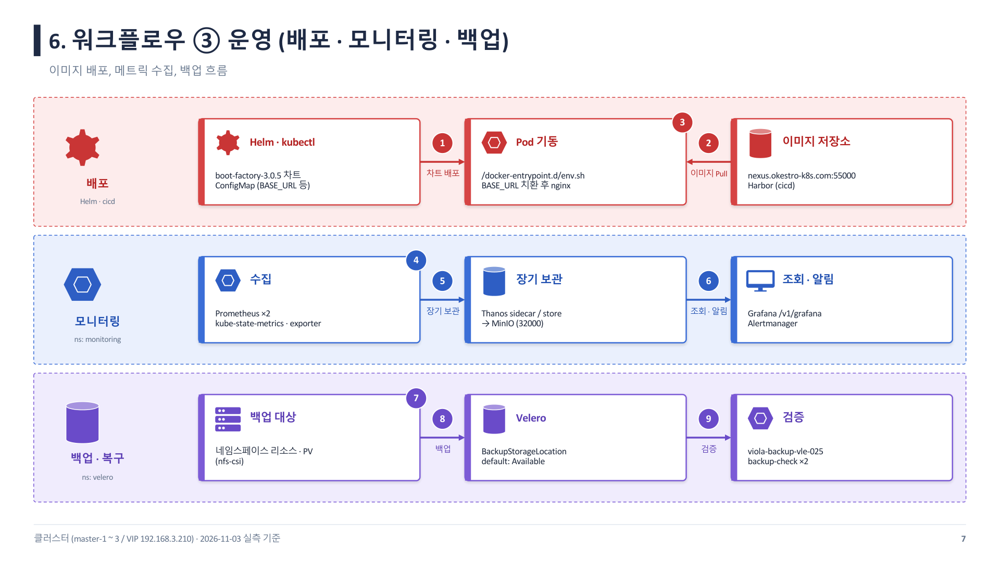

임베딩 모델이 카드 한 장을 수백 차원의 숫자(벡터)로 바꾼다. 뜻이 비슷한 카드는 좌표 공간에서 가깝게 모인다.

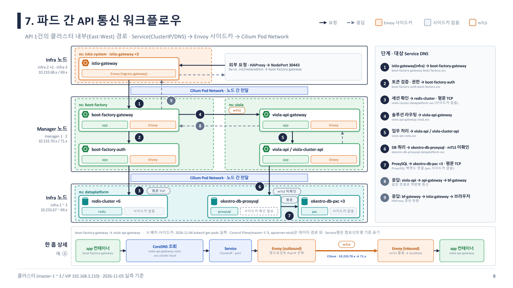

질문이 오면 같은 방식으로 벡터를 만들고, 가까운 카드를 고른다. 단어가 거의 안 겹쳐도 의미 유사도로 규정 카드가 위로 올라올 수 있다.

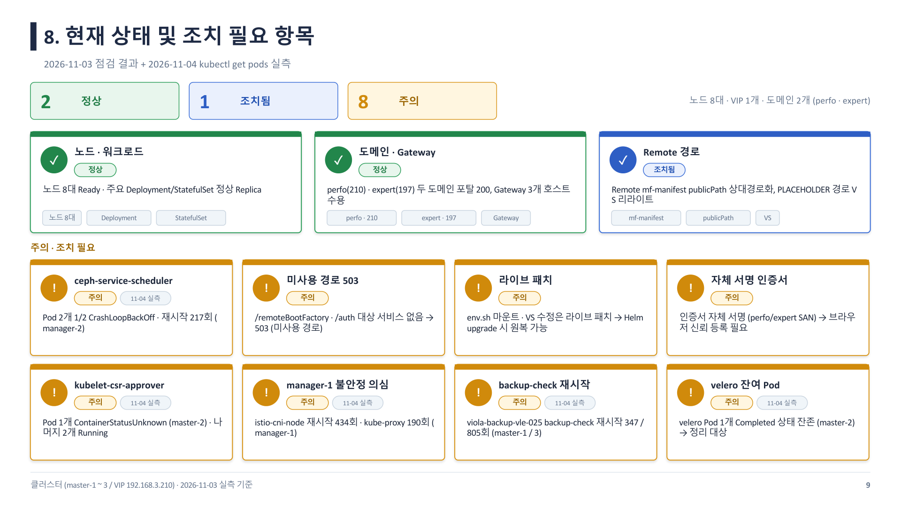

## 3단계 PROMPT: 근거 안에서만 답하기

찾은 카드만 프롬프트에 넣고, “이 텍스트만 근거로 답하라”, “조항을 밝혀라”처럼 지시를 붙인다. 지어내기를 줄이고 사람이 출처를 검증할 수 있게 하려는 장치다.

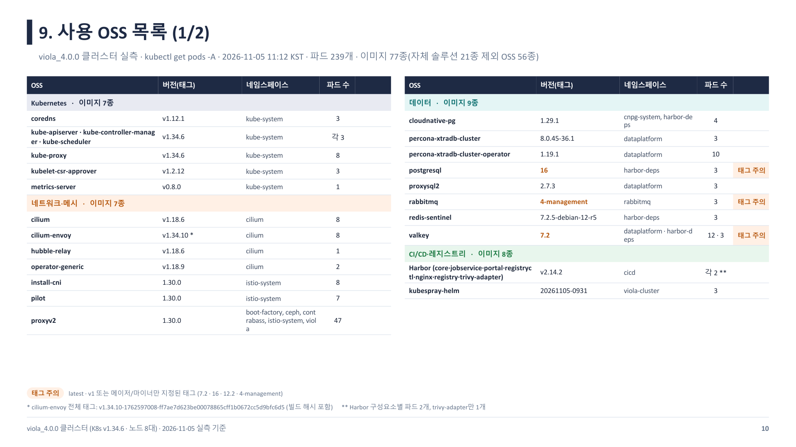

## 정리

먼저 찾고(RETRIEVE), 그다음 답한다(GENERATE). 카드로 자르고, 임베딩으로 뜻을 비교해 찾고, 그 조각만으로 프롬프트를 조립한다.

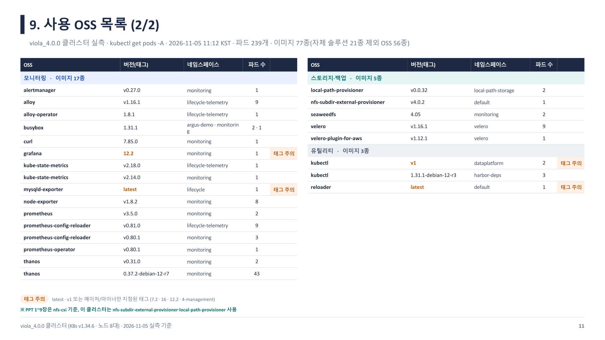

원본 슬라이드: [RAG_동작원리.pptx](/files/RAG_동작원리.pptx)
